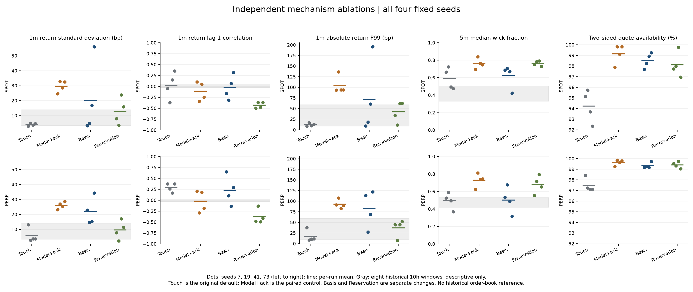
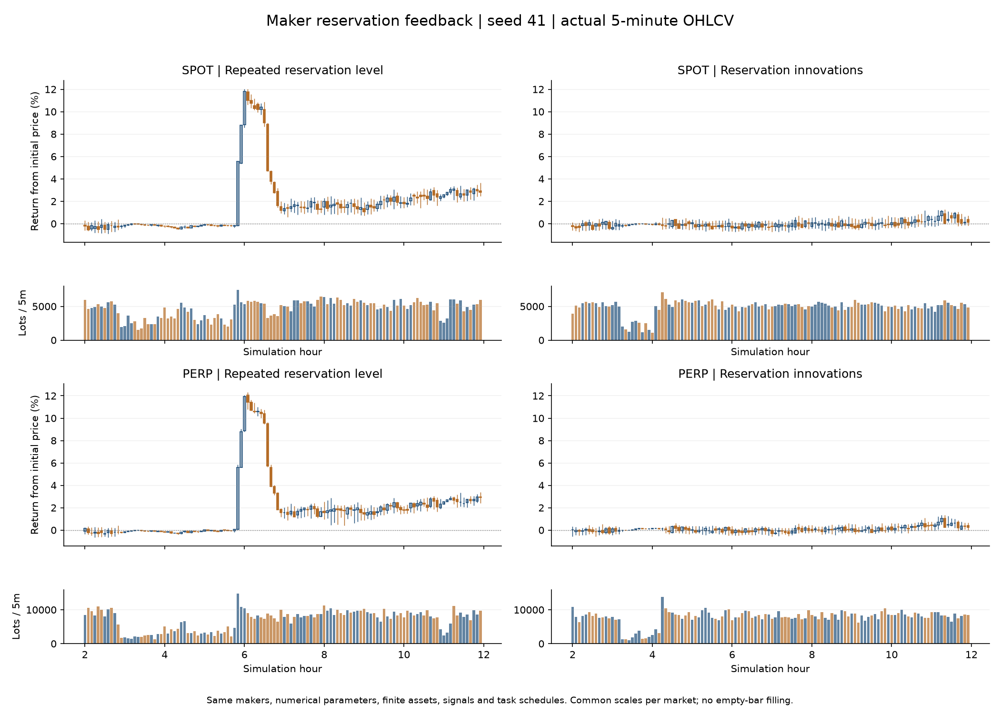
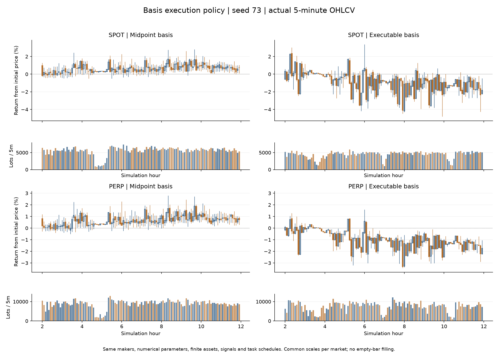

# MarketForge：可执行套利与报价反馈的固定种子探索

本报告对应 `E:\projects\MarketForge-tuning` 的后续实验。生产默认仍是
原来的 touch 报价；两项新机制均为显式开启的实验策略。本轮不调整数值参数，
不修改撮合成交价，不注入目标价格路径，不平滑或补造 K 线。

## 实验设计

两组独立消融，各用 300 个原生 bot、种子 7/19/41/73、每次 12 小时、
1 秒步长，主要评价窗口 `[2h,12h)`。每组另跑一次种子 41 的完整旧策略，
检查其成交、资产、盘口和策略状态回执是否与上一轮逐字节一致。
两组的配对对照都是上一轮已被否决的 `model_ack`，并非原始 touch 默认。
报告额外列出 touch，避免把“比坏候选好”写成“比原实现好”。

所有策略数值、资本、初始库存、角色分配、种子和执行任务相同：

1. **可执行套利**：BasisLinkTrader 1.1.0 改用现货/永续真正可买卖的两边报价，
   按两边可见深度和现货实际对冲预算限制首腿数量，等待真实持仓完成对冲后再开首腿。
   两腿仍分别成交，不能保证无风险或一定对冲成功。做市策略保持旧版。
2. **报价偏移变化**：做市中心使用 `观察中价 + 当前有界偏移 − 上次已确认偏移`，
   避免同一库存/微价格偏移经同行报价绕回后再次累加。只有真实挂单确认才推进记忆；
   保留新成交流的响应。套利仍为旧版。这是闭环报价的模型假设，不是 GLFT 的等价变形。

种子均曾在上一轮观察，种子 41 是已知异常的诊断样本，没有独立留出集。
两项机制没有组合测试。完整操作说明见 [实验说明](../MARKET_QUOTE_FEEDBACK_EXPERIMENTS.md)。

## 完整结果（2026-10-25 汇总）

10 次新增完整运行全部成功：8 次候选运行、2 次旧策略复跑，共 120 个模拟小时。
两份种子 41 旧策略回执均与上一轮完整回执逐字节一致。没有删除种子或失败结果。

**两项策略均不提升为默认。** 可执行套利缺乏跨种子稳定性；报价偏移变化缓解了大幅波动，
但持续产生过强的分钟反转和长影线。当前结果不足以称为真实市场。

以下是四个种子各自统计量的算术平均，不是把收益序列合并后的统计：

| 市场 | 策略 | 1m 收益标准差 bp | 1m 绝对收益 P99 bp | 双边盘口 % | 中位价差 bp | 5m 中位影线占比 |
|---|---|---:|---:|---:|---:|---:|
| SPOT | 原始 touch（背景参照） | 4.02 | 11.91 | 94.23 | 0.32 | 0.589 |
| SPOT | 旧 model_ack（配对对照） | 29.64 | 104.47 | 99.15 | 12.68 | 0.762 |
| SPOT | 可执行套利 | 20.22 | 70.92 | 98.53 | 4.04 | 0.621 |
| SPOT | 报价偏移变化 | 12.77 | 42.29 | 98.12 | 6.85 | 0.764 |
| PERP | 原始 touch（背景参照） | 5.83 | 17.12 | 97.46 | 0.23 | 0.496 |
| PERP | 旧 model_ack（配对对照） | 26.11 | 92.83 | 99.63 | 7.89 | 0.730 |
| PERP | 可执行套利 | 21.77 | 82.82 | 99.33 | 1.38 | 0.503 |
| PERP | 报价偏移变化 | 9.65 | 37.03 | 99.41 | 3.22 | 0.679 |

逐种子主要结果如下；每格为“分钟收益标准差 bp / lag-1 自相关 / 绝对收益 P99 bp”：

| 市场 | 种子 | 旧 model_ack | 可执行套利 | 报价偏移变化 |
|---|---:|---:|---:|---:|
| SPOT | 7 | 24.61 / +0.104 / 93.71 | 3.23 / -0.163 / 8.89 | 7.99 / -0.498 / 33.94 |
| SPOT | 19 | 32.86 / -0.341 / 136.51 | 4.80 / -0.315 / 18.21 | 3.47 / -0.365 / 11.12 |
| SPOT | 41 | 28.63 / +0.052 / 93.81 | 16.78 / +0.064 / 60.86 | 23.76 / -0.480 / 61.73 |
| SPOT | 73 | 32.48 / -0.249 / 93.85 | 56.07 / +0.320 / 195.70 | 15.88 / -0.367 / 62.38 |
| PERP | 7 | 23.19 / +0.206 / 91.44 | 22.87 / +0.652 / 113.43 | 7.73 / -0.484 / 44.31 |
| PERP | 19 | 27.02 / -0.288 / 107.40 | 14.59 / +0.104 / 27.30 | 2.29 / -0.132 / 7.40 |
| PERP | 41 | 25.49 / +0.180 / 82.97 | 15.22 / -0.135 / 68.70 | 17.13 / -0.494 / 44.34 |
| PERP | 73 | 28.75 / -0.185 / 89.51 | 34.39 / +0.289 / 121.87 | 11.47 / -0.407 / 52.07 |

可执行套利使平均套利主动成交占比从现货 38.3%、永续 33.8% 降至 1.8%、1.1%。
它消除了部分不可执行的交易机会，但同时改变了价格传导。种子 73 现货波动从
32.48 升至 56.07 bp，永续从 28.75 升至 34.39 bp；种子 7 永续出现约 7.4% 的实际下探。
这一方案不能凭种子 41 的改善判为成功。

报价偏移变化使四个种子、两个市场的波动及绝对收益 P99 均较 model_ack 下降，
平均标准差现货下降 56.9%、永续下降 63.0%。但是现货自相关仍在 −0.498 至 −0.366，
永续在 −0.494 至 −0.132；现货 5m 中位影线占比平均 0.764，未比旧对照 0.762 改善。
种子 41 的 12% 泡沫消失，但分钟图仍明显来回振荡；种子 73 后段再现长影线。
种子 19 的永续标准差仅 2.29 bp，低于本轮所有历史 10h 窗口，也不能把越平稳当作越真实。

原始 touch 的平均标准差为现货 4.02、永续 5.83 bp，仍低于两项新候选。
其双边盘口更差，部分种子自相关也异常；它同样没有通过完整真实性验证。

### 同长度真实窗口的描述性范围

| 市场 | 1m 标准差 bp | 1m 自相关 | 1m 绝对收益 P99 bp | 5m 中位影线占比 |
|---|---:|---:|---:|---:|
| SPOT | 3.222–13.831 | -0.027–0.042 | 8.766–59.116 | 0.330–0.504 |
| PERP | 3.339–13.845 | -0.031–0.030 | 9.361–59.503 | 0.419–0.531 |

事后增加的跨市场检查也显示约束不足。历史 8 个窗口的现货/永续分钟收益相关性为
0.978–0.998；可执行套利为 0.026–0.653，报价偏移变化为 0.070–0.579。
可执行套利种子 7 的分钟收盘价绝对基差最大约 710 bp，历史参考最大约 8.2 bp。
这里对齐的是两边的分钟成交收盘价，既不是同一瞬间的可执行报价，也不能据此计算套利利润。
这项检查在看到种子 7 异常后加入，只提供后续诊断方向。

### 图和逐项数据

全部种子的完整 5m 图和最后两小时 1m 图均保存在两个原始实验目录和证据 ZIP 中，
没有只保留表现好的种子。[逐种子汇总 CSV](2026-10-24-market-feedback-comparison.csv)。

## 已定位的机制与诊断边界

仅排除自己的挂单，并不能排除自己的报价通过其他做市商再传回来。
`maker_reference_probe` 在共同预热后固定库存、没有任何新成交，只回传报价：
原有设置下 2 个或 8 个 maker 在 8 分钟内继续下移 1,200 tick；新策略在该夹具中
不再持续累积。1 个 maker 的两个版本均变化 5 tick。
这是观测层合成实验，未运行完整撮合、资金清算和强平，因此不是市场真实性证明。

使用种子 41 的 15 个现货 maker 数值配置，固定压力库存为“目标 + 库存上限的四分之一”，
原方案报价中心变化约 −2,792 至 −3,101 tick；新方案约 +155 至 +341 tick。
这里复用的是配置，资金与库存不是原市场的启动账户，也不能声称新方案完全不漂移。

可执行套利种子 7 的永续最低成交价为 92,607（初始 100,000），发生在 6.2925 小时。
同时段实际盘口也下移，排除了单纯绘图错误。低点前后各一分钟，反应型交易者占主动
成交数量 1,871/2,610（约 71.7%），套利账户占 114/2,610（约 4.4%）。
但回执不能区分账户的主动策略成交和强平成交，也没有当时每个策略的完整状态，
这些数字不证明是谁最先触发下跌。

另一个事后检查按每秒将真实成交只保留最后 32 条。种子 41 旧对照下，潜在遗漏量占
现货 5.69%、永续 3.62%；可执行套利组为 2.57%、2.74%。原生观测有最近 32 条限制，
但这里没有复原每个 bot 的唤醒时点及同一秒内执行次序，因此它只衡量截断压力，
不能当作实际信号遗漏率或本次异常的因果证明。

做市新方案另有 2 小时启动诊断：仅看第 10–120 分钟，现货分钟收益标准差
20.07→21.32 bp，永续 20.58→18.16 bp；lag-1 自相关分别
−0.335→−0.441、−0.336→−0.540。该样本仍在主实验预热期内，不能替代完整结果，
也没有用来重新调参。

## 真实行情参照

在首个套利结果产生后，按固定日历选择 2025-01-02、04-02、07-02、10-02，
读取 BTCUSDT 现货与 USD-M 永续的官方逐笔聚合成交归档，逐份核对官方 SHA-256。
格式及 2025 年现货时间戳单位依据
[Binance public-data 文档](https://github.com/binance/binance-public-data)。
每个市场有 4 个完整交易日，以及每日起点为 00:00、12:00 的两个不重叠 10 小时窗口。
参考值只用于事后检验，没有回灌到 bot 或用于挑参数。

这些窗口范围是描述性样本范围，不是置信区间，也不能覆盖全部市场状态。
参考数据没有历史订单簿，不能据此验证模拟价差或深度。各组原有配对图保留并注明
单日参照；新的总览图才使用四日的 10 小时窗口。所有模拟图均来自真实成交 OHLCV，
对应面板使用共同坐标范围。

## 复核和证据

已通过 `cargo test -p exchange-core --lib`：452 passed、0 failed、12 ignored；
独立报价反馈示例测试 1 项通过；配方和分析 Python 测试 12 项通过。
版本、恢复、拒单、部分对冲、真实网关挂单确认、同一时刻幂等及旧配方保持均有覆盖。
测试通过只说明实现契约，没有把统计失败改写成市场通过。

本轮三个 Rust 文件按仓库 edition 2024 的格式检查通过，`git diff --check` 通过。
全仓 `cargo fmt --all -- --check` 仍失败，差异来自未修改的
`position_protection.rs`、`room.rs`、`simulation.rs` 及部分 server 文件；
完整输出保留在 `workspace-format-existing.log`，本轮未改动这些文件。

两个冻结可执行文件的 SHA-256：

- 可执行套利：`0182f0d33df9c3aeeac1d1eb3b5e450d12897dbcf27cce320be245d80a3d43c3`
- 报价偏移变化：`62867d4ef2abc39efeb85e3388aae6d403ac76e28cca6a1b04b916a931545a46`

原始控制回执 SHA-256：
`802e008a14836aa743a1a8bf5303b6134ea4e8bb3ebe28152004d8e4cf25dde6`。
两组完整复跑都得到该值。原始上一轮证据 ZIP 保持不变。

[本轮证据 ZIP](2026-10-24-market-feedback-evidence.zip) 包含冻结计划、配方、运行元数据、
各项统计、实际 OHLCV、全部图、构建/测试日志、诊断输出、参考校验和与当前源码快照。
大体积原始回执和冻结二进制留在 `.local/strategy-research-basis-20261024` 与
`.local/strategy-research-reservation-20261024`，文件身份见 ZIP 的 MANIFEST。
套利二进制先于报价偏移代码构建，因此当前源码快照同时包含两项可选实现，
不宣称能从当前源码获得逐字节相同的旧二进制。复制计划复现时需使用新输出目录。

本轮代码和报告保留在工作区，未提交或推送。两项策略仍需显式选择。

## 下一步应验证的机制

优先增加日内因果轨迹：记录报价参考、库存/资金预算、目标价、实际挂撤单确认、
对冲残差和成交触发来源，并贯穿单次异常波段，区分库存风险调整、主动追价与强平。
同时检查跨市场对冲为何在大基差时仍不能恢复联系，以及观测流截断是否改变真实信号。
这些都有当前异常证据支持；单纯缩小波动或影线不应作为下一轮目标。

本轮只评价 300 个原生 bot。上一轮 3,300 bot / Pine 扩展因兼容性错误在预热中失败，
本轮没有靠删除失败脚本获得通过；不能从这里推出大型混合群体已经合格。
资产检查只覆盖回执起止余额恒等式，不是完整日内费用、保险和强平账本审计。
内存调度曾暂停/恢复模拟进程，不改变市场时钟；墙钟时间不能用作性能对照。
