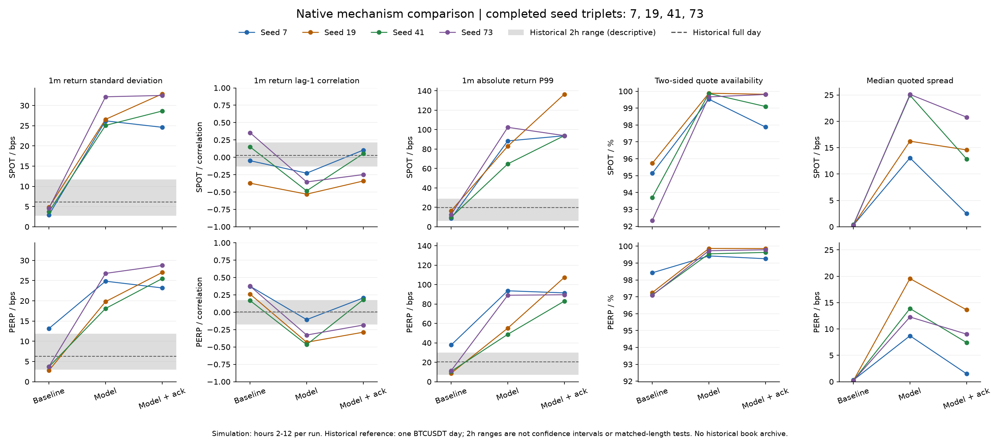
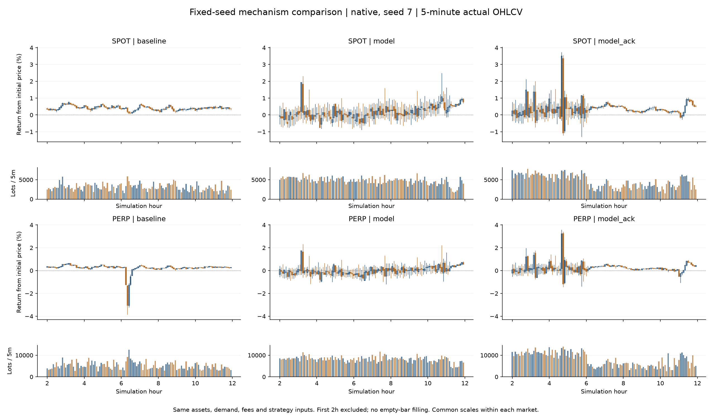

# 2026-10-24 交易机制固定种子实验

本轮完成了撤单后补单调度的可选实现，以及 4 个种子、3 个方案的原生市场对照。**双边报价连续性改善，但 K 线和收益统计没有整体改善，两个候选方案均不晋升为默认配置。** 额外的 3,300 bot 对照全部在预热期发生 Pine 兼容性错误，没有可用的规模市场统计。

代码位于 `E:\projects\MarketForge-tuning`，分支 `feat/endogenous-market-tuning`，实验起点为 `3167ded3ceca11c80bdbb9293a01861a371887be`。本报告记录工作区变更，未提交或推送。保留原默认配置不代表原模型已达到真实市场标准。

## 改动与固定条件

三组方案：

| 方案 | 报价构造 | 撤单后的调度 |
| --- | --- | --- |
| baseline | 原有 touch 覆盖：部分做市商强制一 tick 半价差、每秒刷新 | 原逻辑，继续等待刷新间隔 |
| model | 去掉最后的 touch 覆盖，恢复原先抽取的模型报价上限和刷新节奏 | 原逻辑 |
| model_ack | 与 model 相同 | 下一个权威观察到来时即可重新评估 |

补单仍以实际订单、可用资金和持仓为依据；旧单还在则继续撤单，不预先释放冻结资产。同一市场时间重复调用保持幂等，快照恢复保留调度行为。新选项仅适用于 AdaptiveLiquidityMaker 1.1.0；冻结的 1.0.0 拒绝它，默认关闭。

model 恢复的是现有报价规则，不是根据结果寻找新参数。需要注意，现有 `max_half_spread_ticks` 同时约束报价中心偏移，因此该实验同时改变价差、中心约束和刷新节奏，不能解释为单一价差系数的因果实验。model 与 model_ack 的差异才单独隔离补单调度；未测 touch 加补单的第四组。

每个种子内，初始资产、账户、手续费、角色配置、策略信号、母单目标及时间安排保持一致；未补充资金、指定价格轨迹或平滑 K 线。成交路径随机制改变而内生变化。

## 实验范围和核验

- 原生组：300 bot，种子 **7、19、41、73**，每种子 3 方案，每次 **12 小时**，共 12 次成功、144 个仿真小时。前 2 小时预热，统计窗口为 `[2h, 12h)`。每个市场每组有 600 根非空 1 分钟 K 线。
- 规模组：复用原 3,300 bot 配方，300 原生实例加 3,000 Pine 实例，241 个不同脚本路径；种子 7、每方案原定 6 小时。角色分配与原生组不同，不能把组间差异直接归因于 bot 数量。
- 真实参照：本地归档的 **2025-01-02 BTCUSDT 现货及永续逐笔聚合成交**，核对过归档 SHA-256。仅有一天；12 个两小时分段的范围是描述性参照，不是置信区间或等长假设检验。没有真实盘口归档，也不把内部 lot 数量等同于 BTC 数量。
- K 线只聚合实际成交，缺失 bar 不填充、不跨缺口计算收益；排除预热区间的跨界收益。图中同一市场使用共同价格及成交量刻度。
- 12 个完整回执均核对 SHA-256、成交唯一 ID 和总数；自成交为 0，结束快照负可用余额为 0，内部现货资产 V 总量变化为 0。现金变动保留在原始统计中；这些检查不构成完整的日内手续费、保险或冻结账本审计。
- 每组最终快照均有 107/107 技术策略 ready、30/30 做市商 calibrated。执行任务完成数按种子分别为 45/45、44/45、43/45、44/45，在三个方案内一致。最终 ready 不证明全部策略在第 2 小时已经 ready。
- 6 项相关 Rust 测试、9 项 Python 测试通过。600 步兼容性对照中，原配置在旧/新可执行文件下的完整 JSON 和文件 SHA-256 均一致；这是有界兼容性证据。

## 原生市场结果

以下为 **4 个种子的等权均值**，每个种子先在 10 小时评价窗口内计算统计量，再求均值。bp 为万分之一；“价差中位数”一列是各次运行中位数的均值。完整逐种子数据见 [CSV](2026-10-24-market-mechanisms-comparison.csv)，不要只看均值。

| 市场 | 方案 | 双边报价占比 | 1 分钟收益标准差 / bp | 绝对收益 P99 / bp | 价差中位数 / bp |
| --- | --- | ---: | ---: | ---: | ---: |
| 现货 | baseline | 94.23% | 4.02 | 11.91 | 0.325 |
| 现货 | model | 99.74% | 27.50 | 84.59 | 19.835 |
| 现货 | model_ack | 99.15% | 29.64 | 104.47 | 12.682 |
| 永续 | baseline | 97.46% | 5.83 | 17.12 | 0.225 |
| 永续 | model | 99.64% | 22.39 | 71.60 | 13.602 |
| 永续 | model_ack | 99.63% | 26.11 | 92.83 | 7.892 |

历史单日的 1 分钟收益标准差为现货 **6.12 bp**、永续 **6.26 bp**，绝对收益 P99 为 **19.83 / 20.49 bp**。两个候选的四种子全窗口波动率均高于该日两小时分段范围的最高值（现货 11.58、永续 11.81 bp）；这提示候选明显过度波动，但一天数据不足以定义所有真实市场状态。

model_ack 相比 baseline 在全部 8 个“种子 × 市场”组合中提高了双边报价占比，也全部提高了收益标准差及绝对收益 P99。**盘口更连续，并未转化为更合理的价格形成。** 25 bp 内盘口深度仍下降：现货买方深度中位数的跨种子均值从 37.75 降至 24.25 lot，永续从 109.75 降至 74.75 lot。

model_ack 相比 model 在 8 个组合中均缩窄价差；但 6 个组合的收益标准差继续上升，报价连续性也没有统一方向的改善。不能单凭撤单等待缩短或一张图更活跃宣布成功。

model 的 1 分钟收益一阶相关系数全部为负，现货范围 **−0.530 至 −0.228**，永续 **−0.467 至 −0.107**，呈明显交替反转。补单调度降低了部分组合的反转，但种子差异仍大：model_ack 的范围分别为 **−0.341 至 +0.104**、**−0.288 至 +0.206**。接近零的跨种子均值可能只是正负抵消。

ReactiveFlowTrader 的主动成交量份额均值下降：现货 81.85% → 43.33%，永续 69.28% → 42.08%（baseline → model_ack）。这是成交组成变化，不是多样性或真实性合格证明；角色按成交账户归属统计，无法单独区分策略主动决策和系统强平。

下图展示预先固定的种子 7、整个 10 小时窗口的 5 分钟实际 K 线。所有种子的完整窗口及末两小时 1 分钟图均保存在证据包中。model 的密集长影线以及 model_ack 的突发运动并不是稳定改善。

## 异常片段的后续诊断

这是看到结果后增加的探索性分析，不是预先规定的成功指标，也未用于回调参数。

报价中点的分钟收益仍然出现大波动和负相关。例如 model 的种子 19 现货中点收益标准差约 23.04 bp、一阶相关约 −0.510；种子 41 约 16.78 bp、−0.448。因此不能把全部异常都解释为宽价差造成的买卖成交价跳动。

种子 41 的 model_ack 在 5.5–6.5 小时出现现货 112032、永续 112299 的最高成交价，相对初始 100000 超过 12%。相同窗口内，BasisLinkTrader 的现货有符号主动成交量由 baseline 的 0、model 的 +315 变为 model_ack 的 +1740 lot，永续则为 0、−204、−1745。ReactiveFlowTrader 两市转为净主动买入，而价值交易者提供净主动卖出；固定执行任务的现货 +111、永续 −70 在三个方案相同。

这些关联使**报价中心、库存反馈、现货—永续联动**成为下一轮机制排查对象；不能据此断言某类 bot 是唯一原因。有符号成交量不是持仓变化，当前账户归属统计也不剥离系统强平。进一步修复应在独立新实验中隔离这些链路，并保持本轮输入和失败证据不变。

## 3,300 bot 规模复验失败

| 方案 | 推算仿真时刻 | 首个错误参与者 | 脚本 | 错误 |
| --- | --- | --- | --- | --- |
| baseline | 84 分 1 秒 | pine-perp-132 | Divergence for Many Indicators v4 ST | invalid price or quantity |
| model | 9 分 1 秒 | pine-perp-114 | BuyTheDip | order value must be numeric |
| model_ack | 50 分 1 秒 | pine-perp-190 | Larry | unsupported strategy.opentrades.entry_price |

时刻按日志的零基步号及 1 秒时钟推算，不是完整回执。三个进程均退出码 1，回执文件为空，未达到 2 小时评价起点。**没有 6 小时规模 K 线、市场改善结论或有效 Pine 活跃覆盖结果。** 没有通过删除脚本、修改输入或缩短窗口替换失败实验。

前两个错误的源码线索分别是默认 100% 止损/止盈计算可能产生零价，以及移位 ATR / valuewhen 的预热缺值；未捕获独立订单参数重放，因此保持为假设。第三个错误明确指出运行路径不支持的 API。完整路径、源文件哈希和日志哈希见证据包内 `scale-failure-audit.json`。这是研究 runner 的中断行为，不能直接推广为线上服务一定以同样方式中断。

## 证据与重现

方法和命令见 [固定种子实验说明](../MARKET_MECHANISM_EXPERIMENTS.md)。[紧凑证据包](2026-10-24-market-mechanisms-evidence.zip) 包含冻结配方、运行元数据、成功及失败日志、各组指标和实际 K 线、九张图、分析源码、运行时输入清单及文件哈希。完整大回执和可执行文件保留在本地 `E:\projects\MarketForge-tuning\.local\strategy-research-mechanisms-20261024`；证据包不含这些大文件或私有运行时本体。

- 候选二进制 SHA-256：`d2b5ec927663e8c57e5b4ca99736edba030c43c3cb43031bd3ae88827b7e773c`。
- 紧凑证据包 SHA-256：`2e7df9279d0fcc5d067edb0d050ce0782d9f6a18ce7abf94b2be734cd065f93c`；ZIP CRC、138 个清单成员哈希及归档源码与工作区一致性均已通过核验。
- 600 步新旧基线一致回执 SHA-256：`8a8af95b56bb729c2d1f56d9aa38aa1a040aef07f181c3c67d09ad33b05817b6`。
- 运行时清单 SHA-256：`ca646967a59205aee0add3f0e4c86b55242f90371affc14a84278e4a8adf050e`。清单在原生批次开始后、所有规模运行之前记录；规模运行前及全部运行后核对 259 个文件一致，不把它表述为原生批次开始前的清单。
- 运行采用一秒离散时钟，盘口为每秒完整动作波结束后的采样，不能声称连续时间内始终有双边流动性。
- 两个 worker 的内存调度对原生进程暂停/恢复共 9 对，全部配平；不暂停 Pine，不改变仿真时钟或输入。耗时不作为性能基准。

实验状态为 **12 成功、3 失败、0 待运行**，所有计划均已有终态；这与“15 次全部完成并通过”不同。默认保持 baseline，新报价及补单开关保留为明确标注的实验选项。
