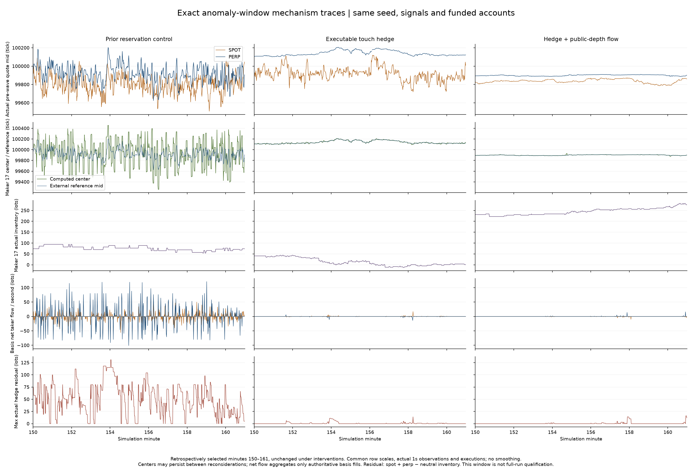
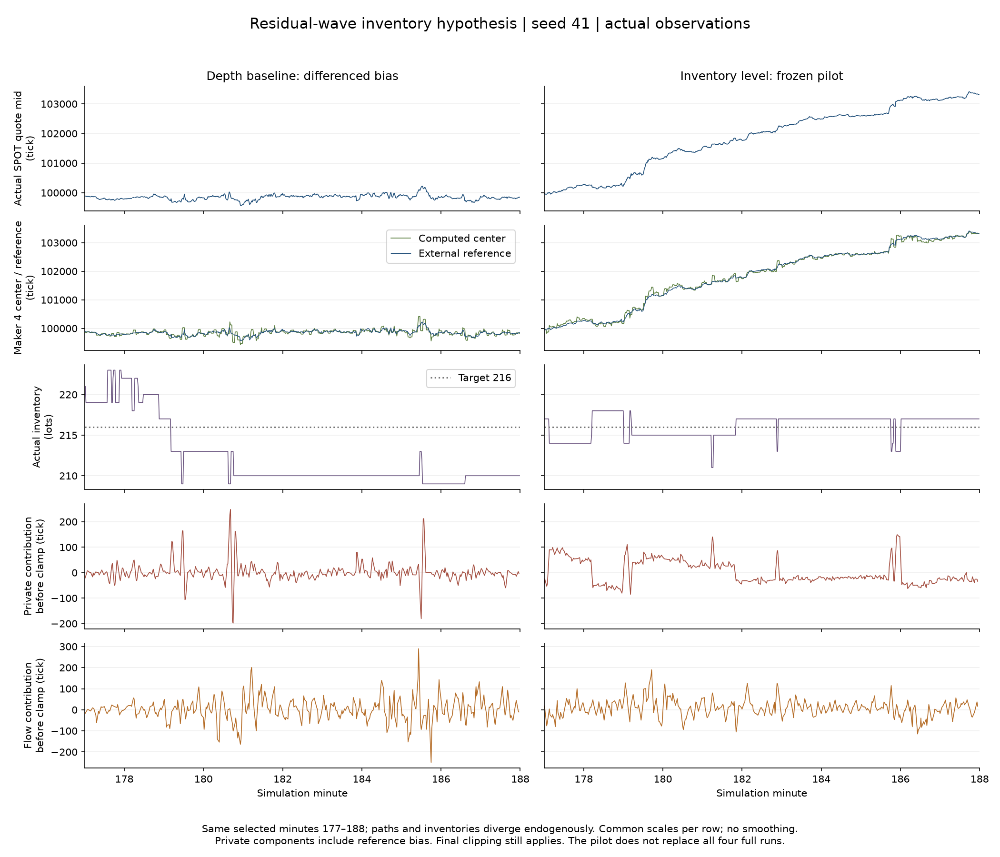
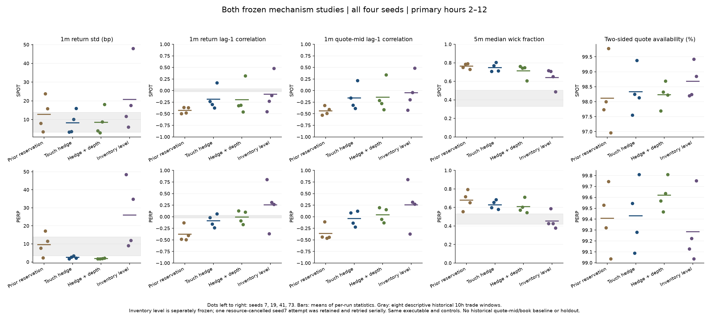

# 异常波段里的报价、库存与套利对冲

本轮确认了可重复的机制缺陷，并完成两套分别冻结的固定种子实验：
**套利执行与补腿修正降低了异常套利流量和残差，但没有使 K 线通过真实性检验。**
外部深度归一化仍有反转和长影线；恢复库存水平的后续假设出现了更强的漂移与尖峰。
全部候选继续保持显式选择，原始 touch 默认未改。

工作区 `E:\projects\MarketForge-tuning`，分支 `feat/endogenous-market-tuning`，
起点 `3167ded3ceca11c80bdbb9293a01861a371887be`。本轮未提交或推送。

## 真实回执复现与异常链条

从上一轮失败的 reservation 控制种子 41 中，在第 2–4 小时按相邻分钟收益乘积最小值
选择第 155 分钟的先跌后涨，追踪第 150–161 分钟 `[9000000,9660000)`。
这是事后选取的诊断，不是留出验证。
开关追踪的 600 步完整回执逐字节一致；旧二进制与最终候选二进制的完整 9,660 步
控制回执也一致，SHA-256 为
`28f61040a004b9634a48801d8f941175ea10dc906e5ca1614abd60979ef5cd22`。
其全部 248,878 笔成交、19,320 份盘口样本与旧完整存档前缀一致。
五份最终诊断追踪的全部成交也与各自独立原生回执逐笔、同序一致：
17,551 / 9,871 / 7,162 / 9,990 / 15,873 笔，market/trade ID 均唯一；
核对价格、数量、时间、双边账户、主动单 ID 和方向。
原生回执不含网关 command ID 和 maker order ID，这两个额外追踪字段没有被该核对独立证明。

轨迹连接实际决策输入、网关执行、库存、资金、清算和强平来源。
旧套利有 143 次同方向加仓提案，其中 136 次不满足配置的**两腿可成交价差门槛**。
加仓实际成交 4,773 手中，4,693 手来自这些提案，约 98.3%。
这不是每次最终持有期都亏损的证明，但证实中价信号没有代表规定的可执行机会。
67 次加仓决策发生时仍有实际未对冲残差。决策波前最大残差 131 手，
逐条网关更新后的波内最大残差实际为 **137 手**；两者口径不同。
1,275 个有残差的现货腿观测中，375 个时点的旧中价滑点带到不了所需触价，或报价不完整。
本诊断段没有强平成交。

一个可精确分解的四秒案例是 `maker-perp-17`：

| 市场时间 | 实际库存 | 外部中价 | 报价中心 | 有界库存／参考偏移 | 新流量响应 |
|---|---:|---:|---:|---:|---:|
| 9,370 秒 | 65 | 100,035 | 100,393.52 | −400 | +358.52 |
| 9,374 秒 | 77 | 99,737 | 99,375.62 | −400 | −361.38 |

中心下跳 1,017.90 tick = 中价下移 298 tick + 流量项反转 719.90 tick。
库存增加 12 手，但有界偏移和已确认偏移都保持 −400，偏移变化项为零。
因此这时持续超目标库存没有继续贡献水平式风险偏移，计算中心主要跟随中价和新流量；
此前的差分模型确实改变了库存控制语义，而不只是防止参考价重复累积。
第二次报价看到的新流量 133 手、净卖出 131 手，其中 120 手是套利账户卖单。
旧流量分母使用自己计划挂单 `3×4=12` 手，计算得到
`−131/(133+12)×400=−361.38 tick`。
同行读取相同公共成交，会把套利首腿／补腿的方向反复继续放大为报价响应。
这支持“中价套利—残差补腿—交替主动成交—同行报价响应—新基差信号”的回路解释，
不证明每个种子、每段异常都由同一来源触发。

## 已实现的机制干预

1. **BasisLinkTrader 1.2.0**：按真实两腿可成交价格、触价深度和实际资金决定加仓，
   已有残差归零前禁止再开首腿。两腿 IOC 使用观测触价，不扫过该价位，不假设必然成交。
   修复实际现货残差只需所消费方向的报价和真实永续持仓，无需无关反向报价存在。
2. **做市公共深度流量模型**：以既有最大报价范围内、扣除实际自身挂单后的外部消费侧深度
   归一化新流量，替代自己计划下单量。未增加系数、资本，未更改匹配规则。
   市场外部深度比旧分母更小时，响应可能更大，因此不是统一压低波动的乘数。

1.2.0 把旧中价滑点带替换为观测触价 IOC；旧数值字段仍保留，但保护语义确有改变。
提交前触价移走时允许不成交。两腿分别清算，没有凭空增加跨市场原子成交或资金预留。
原版本及默认分支保留，实验仅通过显式版本／布尔选项开启。
触价套利是一组信号、预算、残差门控和执行一致性的干预，主对照不能分别分配各子修正的效应。

原选定段的实际执行对照如下。残差按 `spot + perp − neutral` 计算；
两个账户腿逐条衔接，每条网关的更新前持仓均验证一致。

| 机制 | 加仓提案 | 不达门槛提案 | 实际加仓量 | 未归零又加仓 | 非零残差 pair-seconds | 平均绝对残差 | 波内最大绝对残差 |
|---|---:|---:|---:|---:|---:|---:|---:|
| 旧偏移控制 | 143 | 136 | 4,773 | 67 | 1,275 / 3,300 | 16.169 | 137 |
| 触价套利 | 71 | 0 | 83 | 0 | 182 / 3,300 | 0.145 | 14 |
| 触价套利＋外部深度 | 0 | 0 | 0 | 0 | 78 / 3,300 | 0.093 | 16 |

深度组这个段**没有新开仓机会**，零错误不能单独作为开仓机制充分验证。
触价组有 33 次提案在有序提交时触价已不可达；不能拿意向订单当作实际成交。
库存残差和现金／费用的局部网关账本保存在各 `*-analysis-v3/hedge-ledger.csv`，不是全局收益审计。

## 剩余反转与库存差分假设

深度组种子 41 的完整现货分钟 ACF 仍为 −0.460。
按同一早期 `[2h,4h)` 选择规则，其第 182 分钟仍有 +31.56 / −20.73 bp 的相邻反转，
因此另追踪第 177–188 分钟。完整前缀与已完成深度组回执一致。
另记录了整个主要窗口中最大的第 710 分钟反转，但未追踪它，不能宣称解释了全部晚期异常。

`maker-spot-4` 在 10,841–10,845 秒库存从 209 回到 213，仍低于目标 216：
有界库存／参考偏移从 +366.725 降到 +168.415，
差分私有项从 +248.155 变为 −198.310；中价变化 −90.5 tick、流量项变化 −83.056 tick，
合计报价中心下跳 **620.020 tick**。该次新报价有真实挂单事件。
这表明此前“当前偏移减上次偏移”可能在库存向目标恢复时制造反向报价压力。
另有库存不变而流量深度改变造成的跳价，不能只归因于库存一项。
所有最终追踪中的做市公式重建误差均小于 `1.5e−11` tick。

据此新建独立的四种子消融：保留触价套利和公共深度，仅移除
`reservation_innovations=true`，恢复已有库存水平策略。
它同时恢复“原始私有偏移加流量后再截断”的旧顺序，因此是这一语义组合的检验。
**同一个冻结二进制，没有新增 Rust 修改、数值或资金。**
全部四个配方在短段 pilot 之前冻结，四次完整实验无论 pilot 好坏均保留。
旧的九次计划与回执没有改写。

短段里库存更贴近目标，ReactiveFlowTrader 成交却从 9,858 增至 20,953 手，
实际现货报价约上行 3.4%。这重现了“减弱反复，却出现漂移”的反例。
本段套利非零残差观测也从 220 增至 615 / 3,300 pair-seconds。
此前独立的无成交同行报价探针已经发现库存水平策略会漂移；这个已知失败未被隐去。
群体核对显示，库存水平组 79.13% 的现货重算观测低于库存目标，平均原始库存／参考项
为 +15.56 tick，加上流量项后，计算中心平均高于参考中价 19.43 tick；
同期 ReactiveFlowTrader 现货净主动买入 835 手，报价中价累计上涨 3.344%。
这与持续私有偏移、同行参考价传导和内生买流量共同推动漂移的解释一致。
这些均值不按深度加权，包含 cancel-only／未挂出的计算，且不是独立样本或因果回归；
不能据此分配漂移的因果百分比。完整描述性核对保存在 `remaining-private-pressure.json`。

## 完整固定种子结果

两套机制设计经过 **14 次完整实验尝试，完成 13 次新增完整运行、156 个完整模拟小时**：
主实验为四种子 × 两机制加一次完整旧控制复跑；后续为四种子 × 库存水平。
另保留一次种子 7 被资源调度主动取消的未完成尝试，最后进度记录为 22,200 步（至少 6 小时 10 分钟），
其退出码为 `4294967295`。这是明确记录的取消，不是成功运行，也没有得到完整市场结果。
进度每 100 步输出一次；最后日志步数是可证实的下界，未完成回执未保存精确停止步数。
当系统可提交内存降到约 2.3 GB 时，仅终止了已验证路径／配方的暂停中实验进程，
保留原计划、配方、部分日志和失败 metadata。随后在新目录以同一冻结二进制、同一配方
串行重跑种子 7，全部种子仍保留。原批次的失败状态没有被改写成成功。
新旧尝试的二进制／配方指纹一致；原尝试已有的每 100 步累计成交数及活跃 bot 数
与重跑至 22,200 步的日志一致。原尝试未输出完整回执，因此不能宣称两次完整价格／账户逐字节一致。
每次 300 个原生 bot、12 小时、1 秒步长；统一主要窗口 `[2h,12h)`，每市场预期 600 根分钟 K 线，
实际各组 600 根；缺失不补造。
所有数值、资金、初始库存、角色、信号生成规则和外生执行任务固定。
内生价格与持仓不同后的实际信号自然分化。
对照是上一轮失败的 reservation 候选，原始 touch 仅作背景，不能混淆。

下表为四个完整种子的均值 **[最小值, 最大值]**，不是把所有收益拼接后的统计。

| 机制 | 市场 | 1m 收益标准差 bp | 1m 收益 ACF(1) | 1m 盘口中价 ACF(1) | 5m 影线比例中位数 | 双边盘口 % |
|---|---|---:|---:|---:|---:|---:|
| 旧偏移控制 | SPOT | 12.772 [3.471, 23.757] | -0.428 [-0.498, -0.365] | -0.437 [-0.530, -0.320] | 0.764 [0.730, 0.792] | 98.117 [96.964, 99.778] |
| 旧偏移控制 | PERP | 9.653 [2.285, 17.134] | -0.379 [-0.494, -0.132] | -0.363 [-0.462, -0.111] | 0.679 [0.555, 0.794] | 99.408 [99.036, 99.744] |
| 触价套利 | SPOT | 8.262 [3.310, 15.946] | -0.186 [-0.373, 0.167] | -0.160 [-0.383, 0.218] | 0.749 [0.708, 0.804] | 98.328 [97.547, 99.381] |
| 触价套利 | PERP | 2.514 [1.782, 3.393] | -0.088 [-0.240, 0.065] | -0.037 [-0.219, 0.123] | 0.629 [0.580, 0.684] | 99.431 [99.089, 99.808] |
| 触价套利＋外部深度 | SPOT | 8.472 [2.993, 18.074] | -0.196 [-0.460, 0.319] | -0.141 [-0.410, 0.338] | 0.714 [0.605, 0.762] | 98.234 [97.694, 98.686] |
| 触价套利＋外部深度 | PERP | 1.904 [1.733, 2.181] | -0.006 [-0.165, 0.125] | 0.042 [-0.128, 0.197] | 0.608 [0.546, 0.710] | 99.619 [99.467, 99.808] |
| 再恢复库存水平 | SPOT | 20.779 [5.953, 47.950] | -0.078 [-0.455, 0.478] | -0.044 [-0.422, 0.484] | 0.640 [0.487, 0.715] | 98.678 [98.203, 99.422] |
| 再恢复库存水平 | PERP | 26.046 [9.022, 48.389] | 0.254 [-0.366, 0.804] | 0.255 [-0.369, 0.805] | 0.455 [0.378, 0.587] | 99.285 [99.036, 99.753] |

影线比例定义为 `(high-low-|close-open|)/(high-low)`，对正振幅 K 线计算，
先对各运行取中位数再汇总；正振幅数量另列在 CSV。
报价中价来自实际盘口，无双边报价时缺失，不补价格、不平滑。
全部种子的收益反转如下，避免均值掩盖某一个种子的失败。

| 种子 | 市场 | 旧偏移控制 | 触价套利 | ＋外部深度 | 再恢复库存水平 |
|---|---|---:|---:|---:|---:|
| 7 | SPOT | -0.498 | -0.235 | -0.327 | -0.455 |
| 7 | PERP | -0.484 | -0.020 | 0.125 | 0.804 |
| 19 | SPOT | -0.365 | -0.301 | -0.315 | -0.226 |
| 19 | PERP | -0.132 | -0.157 | -0.088 | -0.366 |
| 41 | SPOT | -0.480 | -0.373 | -0.460 | -0.107 |
| 41 | PERP | -0.494 | -0.240 | -0.165 | 0.310 |
| 73 | SPOT | -0.367 | 0.167 | 0.319 | 0.478 |
| 73 | PERP | -0.407 | 0.065 | 0.103 | 0.269 |

原始 touch 的旧四种子结果另作背景，不混入本轮配对均值。
它的价差／刷新等配方与当前实验不同，不能把下面的差异全部归因于本轮单一机制：

| 原始 touch 背景市场 | 标准差均值 bp | ACF 均值 [种子范围] | 5m 影线比例均值 | 双边盘口均值 % |
|---|---:|---:|---:|---:|
| SPOT | 4.021 | 0.021 [-0.373, 0.355] | 0.589 | 94.230 |
| PERP | 5.835 | 0.295 [0.168, 0.376] | 0.496 | 97.465 |

原始 touch 的现货平均 ACF 有种子间正负抵消，永续则持续正相关；两市场盘口可用性也较低。
因此平均 ACF 或单项波动接近历史范围，都不足以认定已真实。

套利修正显著减少了旧大幅震荡源，但不是所有种子都改善：种子 19 永续收益标准差
从 2.285 升至 2.752 bp，ACF 从 −0.132 变为 −0.157。
公共深度也不是稳定胜出：种子 7 现货 ACF 从触价组 −0.235 变为 −0.327，
种子 41 从 −0.373 变为 −0.460。长影线仍明显。
种子 73 的触价套利组虽减少反转，现货标准差却从 15.875 升至 15.946 bp，
绝对分钟收益 P99 从 62.38 升至 81.29 bp，收盘基差 P99 从 43.94 扩至 101.85 bp。
这些退化没有从均值或图中删去。
深度组种子 73 的现货标准差进一步到 18.074 bp，基差 P99 到 134.92 bp。
永续深度组的平均 ACF 为 −0.006，但四个种子范围是 −0.165 至 +0.125；
均值接近零部分来自正负抵消，不能代替逐种子验证。

库存水平的完整价格路径变化另列（首根开盘至末根收盘），不能用 ACF 靠近零来掩盖趋势漂移：

库存水平种子 41 的现货反转减弱，但永续 ACF 变为 +0.310，标准差从深度组
1.902 升至 11.950 bp；种子 19 则重新出现 −0.366 的永续反转，
标准差从 1.801 升至 9.022 bp，最大收盘基差从 26.00 扩至 222.54 bp。
因此既有改善项，也有相反方向的退化，不能从某一张较正常的 K 线做推广。
种子 73 的库存水平现货 ACF 达 +0.478、标准差 47.950 bp；
基差 P99 为 349.07 bp、最大 451.77 bp。其现货影线比例反而从深度组 0.605 降至 0.487，
说明单项蜡烛形态更接近历史范围，并不意味着价格形成或跨市场联系更正常。
种子 7 的库存水平永续标准差为 48.389 bp、ACF 为 +0.804，最大收盘基差达
1,644.06 bp（16.44%）；盘中最低成交价较初始价格低 17.208%，但主要窗口结束时
开盘至收盘变化只有 −0.54%。仅看结束位置会掩盖这类严重偏离。
这些后续极端段只做了完整回执与统计核验，未逐段增加因果追踪；
本轮不能把它们全部归因于已选定的两个波段，也不能从局部无强平成交外推全程无强平。

- SPOT 在主要窗口内的价格变化为 种子 7: -0.49%；种子 19: -0.03%；种子 41: 5.75%；种子 73: -0.47%
- PERP 在主要窗口内的价格变化为 种子 7: -0.54%；种子 19: 0.04%；种子 41: 5.19%；种子 73: -0.52%

联动和基差也不应被低波动替代评价：

| 种子 | 机制 | 现货／永续分钟收益相关 | 绝对收盘基差 P99 bp | 最大绝对收盘基差 bp |
|---|---|---:|---:|---:|
| 7 | 旧偏移控制 | 0.579 | 63.03 | 72.87 |
| 7 | 触价套利 | 0.135 | 29.79 | 34.57 |
| 7 | 触价套利＋外部深度 | 0.260 | 33.11 | 37.40 |
| 7 | 再恢复库存水平 | 0.072 | 1021.55 | 1644.06 |
| 19 | 旧偏移控制 | 0.070 | 37.99 | 45.69 |
| 19 | 触价套利 | 0.017 | 34.12 | 50.44 |
| 19 | 触价套利＋外部深度 | 0.083 | 22.69 | 26.00 |
| 19 | 再恢复库存水平 | 0.060 | 66.68 | 222.54 |
| 41 | 旧偏移控制 | 0.239 | 47.63 | 57.14 |
| 41 | 触价套利 | 0.163 | 39.37 | 47.75 |
| 41 | 触价套利＋外部深度 | 0.189 | 42.49 | 72.33 |
| 41 | 再恢复库存水平 | 0.597 | 48.52 | 72.80 |
| 73 | 旧偏移控制 | 0.455 | 43.94 | 59.29 |
| 73 | 触价套利 | 0.487 | 101.85 | 157.83 |
| 73 | 触价套利＋外部深度 | 0.481 | 134.92 | 174.15 |
| 73 | 再恢复库存水平 | 0.549 | 349.07 | 451.77 |

历史参照为官方 Binance BTCUSDT 现货／永续 aggTrades 的
2025-01-02、04-02、07-02、10-02（UTC），每日两个互不重叠十小时窗口。
原下载 ZIP 和校验和被重新验证。它只是描述性范围，八个窗口不是置信区间，
也没有历史盘口中价可对照。数据来源：[Binance Public Data](https://github.com/binance/binance-public-data)。

| 市场 | 窗口数 | 1m 标准差 bp | 1m 收益 ACF(1) | 5m 影线比例中位数 |
|---|---:|---:|---:|---:|
| SPOT | 8 | 3.222 至 13.831 | -0.027 至 0.042 | 0.330 至 0.504 |
| PERP | 8 | 3.339 至 13.845 | -0.031 至 0.030 | 0.419 至 0.531 |

完整 K 线直接按真实成交合成，5 分钟 OHLCV，不补空 K 线。
每张图各市场共用价格、成交量尺度；完整主要窗口与最后两小时图均归档，
不能只展示末尾较平静的一段。全部种子：

- 种子 7：[主实验三组 K 线](2026-10-25-market-causal-main-seed7.png)，[深度控制／库存水平 K 线](2026-10-25-market-causal-level-seed7.png)。
- 种子 19：[主实验三组 K 线](2026-10-25-market-causal-main-seed19.png)，[深度控制／库存水平 K 线](2026-10-25-market-causal-level-seed19.png)。
- 种子 41：[主实验三组 K 线](2026-10-25-market-causal-main-seed41.png)，[深度控制／库存水平 K 线](2026-10-25-market-causal-level-seed41.png)。
- 种子 73：[主实验三组 K 线](2026-10-25-market-causal-main-seed73.png)，[深度控制／库存水平 K 线](2026-10-25-market-causal-level-seed73.png)。

逐种子尾部、盘口价差、活跃账户、成交量关系、价格范围和反转见
[32 行完整统计 CSV](2026-10-25-market-causal-comparison.csv)，跨市场指标见
[联动 CSV](2026-10-25-market-causal-market-links.csv)。
CSV 另列最长单边盘口中断、P90 价差、实际主动单方向持续性、各组套利／流量成交量。
分钟零收益比例、最长同向收益连续段和实际／正振幅 K 线数量也保留。
其中深度指标是八层可见盘口样本内的 25bp 数量，不代表全簿深度；
个别诊断的精确做市计算使用该次观测真正可见的全部外部层级，口径不同。

## 验证边界与交付

- 最终二进制 SHA-256：`2ba563200bda1baca2191b064ae935db18bd9b4f04c0b1f78833283decdfb926`。
  13 次新运行均使用该文件。完整种子 41 旧控制复跑回执与存档逐字节一致：
  `e92cd93de597e612826314510ec78be9f11f19c455801fe1f31b5770af105c09`。
  库存水平对照由同一未重建的二进制提前完成，并验证四个配方、回执、指标哈希。
- 核心库测试 **456 通过、12 忽略、0 失败**；报价探针 1 通过；机制／执行／新配方 Python
  测试合计 **14 通过**。修改的 Rust 文件格式检查和 `git diff --check` 通过；
  全工作区格式检查仍有既存无关差异，未扩改。
- 16 个对照／候选运行均成交计数一致、无自成交；端点负可用余额记录合计 0。
  这是端点账户与会计检查，不覆盖每个盘中资金预留或完整手续费／保险账本。
  拒绝动作保留（合计 107288 次），不是丢掉后再统计。
- 所有内置技术周期在完整运行结束时已准备好；外生执行任务的实际完成量仍可能不足，
  没有补造成交：旧偏移控制 39213/39884 手；触价套利 39203/39884 手；触价套利＋外部深度 39211/39884 手；再恢复库存水平 39185/39884 手。
- 实际成交流观察还存在 last-32 截断：原异常段的 spot maker-0 共漏掉约 5.98% 的
  实际新成交量，660 次观测中 6 次出现非零流量符号相反。逐观察的历史 trade-ID 区间核对
  没有读取未来成交。只核对了两个 maker 和选定窗口，不能外推全部群体；该问题本轮未改。
- 四个种子此前已看过，两个诊断均事后选择，后续假设又基于种子 41 的反馈；
  没有独立留出验证。1 秒时钟没有检验亚秒队列真实性。
  300 原生 bot 结果不等于已通过此前失败的 3,300／Pine 群体资格。
- 资源调度只暂停／恢复精确匹配本实验路径的原生进程及其批次启动器；模拟时间不变。
  后段暂停批次派发，等现有原生子进程结束再启动下一组，以控制累计内存。
  墙钟耗时含内存等待，本轮不作为性能基准。
- 记录过测试夹具微价混淆和目录身份防护拒绝的失败，均保留原日志；
  最终追踪分析修正了 cancel-only 重算和观测确认内存口径，使用 schema 3。
  没有通过改资金、波动系数、目标曲线、平滑、换热身窗或删种子取得结果。

机制和复现步骤见 [实验协议](../MARKET_CAUSAL_EXPERIMENTS.md)。
[证据归档](2026-10-25-market-causal-evidence.zip) 包含冻结设计、配方、全部种子 K 线／指标、
最终追踪 CSV、实际残差账本、源码快照与构建／测试／错误日志。
多 GB 完整回执、原始追踪和二进制留在清单记录的本地路径；清单记录 SHA-256，
不能把精简 ZIP 当作包含全部原始字节的自足包。
旧两份归档保持原哈希；最终 ZIP 另检查 CRC、每成员 SHA-256 和重复路径。

当前结论是**已定位到可复现的套利执行与做市反馈缺陷，执行修正显著降低了选定段的实际对冲残差；
整体 K 线仍不合格，做市反馈模型仍需重构，库存水平替代不能直接采用**。
后续应围绕同行参考价传导、实际成交观察完整性与流量响应时序继续检验，
而不是继续压缩波动或把这轮候选设为默认。
