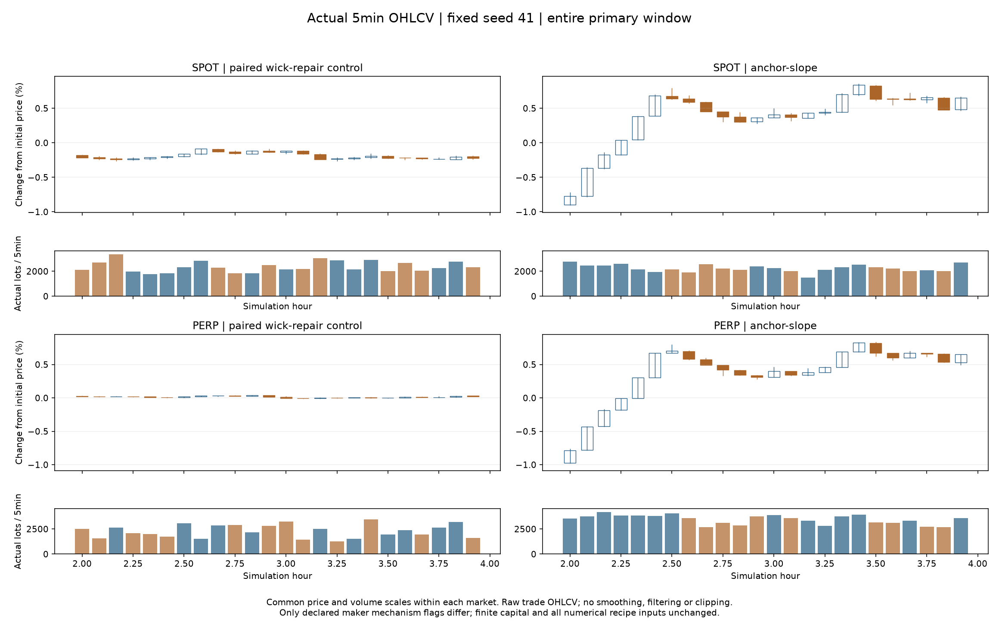
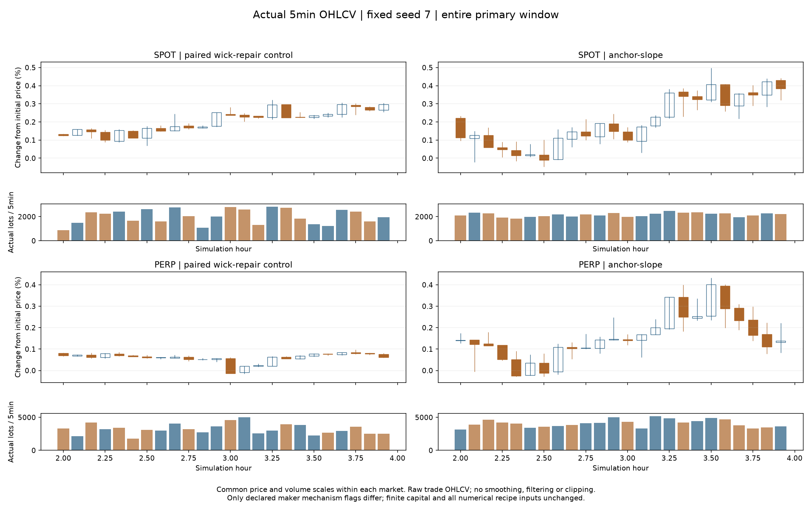
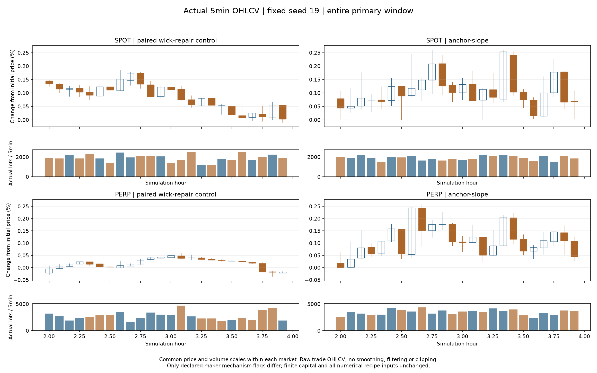
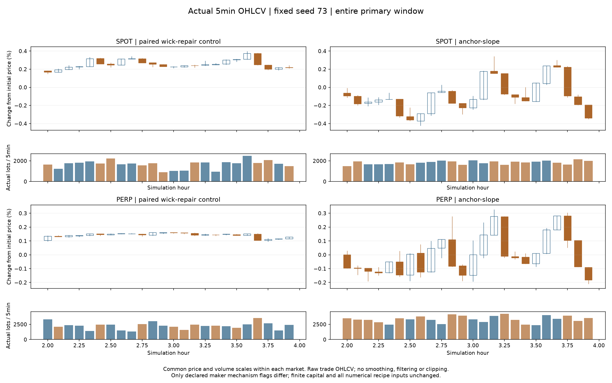

# 拆单之后：持续价格形成与现货／永续联动

本轮控制为上一轮长影线修复后的双触价执行组合（dual-execution），并非更早的扫单市场。只改变显式做市机制开关，没有调整波动率、价差、订单量、风险、指数权重、手续费、资金或套利容量的数值。OHLCV直接聚合真实撮合成交。

## 结论与选择

本轮完成了持续指数锚与盘口供给曲线响应的机制实现和四种子四小时配对，但组合未通过整体市场统计验收，不提升为默认配置。波动幅度和常态基差改善：分钟标准差现货1.525→4.161bp、永续0.576→3.920bp；四个种子的绝对分钟收盘基差中位数均下降，其算术均值13.77→4.10bp。改善同时伴随回退：现货5m双长影线频率10.4%→14.6%，种子7／19有形态回退，种子7／73基差P99扩大，种子73平均未对冲时间也从1.63%升到11.46%，收益ACF均值约0.24／0.25且出现25分钟同向序列。种子101短留出也改善了影线、波动和基差，但不能抵消这些失败分组或补足12小时缺口。

只修指数恢复基差但两市场影线回退；只改供给曲线提高波动并改善形态，但基差P99未改善。组合在初筛中同时提高两市场波动、降低影线和基差，成交活动及双边盘口总体保留，故选择两项组合。风险也已见到：现货／永续收益ACF约0.25／0.42，最长同向分钟25／16，需重点防止趋势反馈过强；形态更顺不能代替该检验。种子101已在任何该种子结果产生前冻结，仅作额外4小时短检验，不据其结果重新挑选。

## 四小时固定种子配对结果

300个有限资金bot，种子41、7、19、73，每组4小时，1秒观察节奏；主统计固定为[2h,4h)，每市场每种子120根1m、24根5m柱。主比较使用Linux同平台控制／候选配对，没有混入Windows旧控制。种子41复用已完整跑出的Linux4h原始回执并核对哈希，其余三种子为新配对。下面是逐种子指标的算术均值（影线为逐种子中位数再取均值），成交量为四种子合计。没有合并中位数或选择性丢弃种子。

**12小时长周期复验未完成。** 两次长尝试被主机内存保护停止，用户明确选择以四小时对照收尾；本轮短窗口改善不能替代长周期资格。

|市场／机制|分钟标准差bp|1m影线占比|5m影线占比|5m双长影线|分钟收益ACF1|零收益分钟|双边盘口|实际成交手数|
|---|---:|---:|---:|---:|---:|---:|---:|---:|
|V-BTC-SPOT / dual-execution|1.525|46.3%|49.8%|10.4%|-0.007|2.7%|100.00%|190,901|
|V-BTC-SPOT / anchor-slope|4.161|35.8%|47.1%|14.6%|0.243|0.8%|99.95%|194,994|
|V-BTC-PERP / dual-execution|0.576|53.0%|52.5%|16.7%|0.092|13.7%|100.00%|252,370|
|V-BTC-PERP / anchor-slope|3.920|28.1%|39.6%|13.5%|0.251|1.3%|99.99%|343,574|

影线占比为(上影+下影)/振幅的非零振幅柱中位数；双长影线为上下影线各占振幅至少25%。零振幅、非空柱、15m／60m、启动30分钟、尾部和成交角色另保存在逐种子指标中；短主窗口仅两根60m柱，不能据其认证小时形态。

|种子／市场|分钟标准差bp：前→后|5m影线：前→后|双长影线：前→后|收益ACF1：前→后|成交量保留|
|---|---:|---:|---:|---:|---:|
|41 / V-BTC-SPOT|1.569 → 4.938|56.3% → 29.0%|16.7% → 4.2%|-0.144 → 0.251|94.9%|
|41 / V-BTC-PERP|0.496 → 4.463|47.1% → 16.6%|12.5% → 0.0%|0.001 → 0.424|150.5%|
|7 / V-BTC-SPOT|1.639 → 3.694|50.2% → 58.0%|4.2% → 20.8%|0.076 → 0.286|106.8%|
|7 / V-BTC-PERP|0.704 → 3.607|49.2% → 56.8%|8.3% → 20.8%|0.149 → 0.182|126.7%|
|19 / V-BTC-SPOT|1.387 → 3.633|45.4% → 62.4%|12.5% → 25.0%|-0.241 → -0.040|99.3%|
|19 / V-BTC-PERP|0.584 → 2.895|50.8% → 51.0%|16.7% → 25.0%|-0.020 → 0.079|126.0%|
|73 / V-BTC-SPOT|1.504 → 4.380|47.3% → 38.9%|8.3% → 8.3%|0.281 → 0.474|110.1%|
|73 / V-BTC-PERP|0.519 → 4.715|63.1% → 34.2%|29.2% → 8.3%|0.238 → 0.317|147.2%|

形态回退分组：7/V-BTC-SPOT/wick_5m: 0.502→0.580; 7/V-BTC-SPOT/both_outer_quarters_5m: 0.042→0.208; 7/V-BTC-PERP/wick_5m: 0.492→0.568; 7/V-BTC-PERP/both_outer_quarters_5m: 0.083→0.208; 19/V-BTC-SPOT/wick_5m: 0.454→0.624; 19/V-BTC-SPOT/both_outer_quarters_5m: 0.125→0.250; 19/V-BTC-PERP/wick_5m: 0.508→0.510; 19/V-BTC-PERP/both_outer_quarters_5m: 0.167→0.250。不能只凭总体均值隐藏这些回退。

|种子|绝对收盘基差中位bp：前→后|P99bp：前→后|最大bp：前→后|分钟收益相关：前→后|
|---|---:|---:|---:|---:|
|41|22.30 → 2.89|26.89 → 8.37|28.68 → 13.24|0.36 → 0.67|
|7|15.86 → 2.90|25.01 → 27.81|25.03 → 30.97|0.23 → 0.35|
|19|6.99 → 2.30|16.20 → 8.75|17.07 → 12.59|0.12 → 0.33|
|73|9.93 → 8.31|21.83 → 37.55|23.01 → 38.56|0.38 → 0.33|

分钟收盘价可能不同步，因此另按同一完整1秒行动波次之后的公开BBO核对。下表毛两腿价差尚未扣手续费／资金费，也不保证下一次下单时两腿都能成交；P99采用无插值的较低顺序统计量。缺少双边报价单独计数，不延用旧报价。

|种子／机制|同波中间价绝对基差中位bp|P99bp|最大bp|毛价差>25bp比例|连续>25bp最长秒|
|---|---:|---:|---:|---:|---:|
|41 / control|22.34|27.77|28.78|7.92%|260|
|7 / control|15.71|25.57|26.77|1.01%|32|
|19 / control|7.39|16.47|16.98|0.00%|0|
|73 / control|10.07|22.57|24.65|0.00%|0|
|41 / anchor-slope|2.73|9.41|14.53|0.00%|0|
|7 / anchor-slope|3.19|29.07|31.81|2.03%|133|
|19 / anchor-slope|2.30|9.43|15.28|0.00%|0|
|73 / anchor-slope|8.00|38.60|43.61|6.36%|185|

|种子|套利平均上限占用：前→后|平均未对冲时间：前→后|最大事件残差手数：前→后|结束最大绝对残差：前→后|
|---|---:|---:|---:|---:|
|41|20.19% → 0.00%|3.01% → 0.00%|22 → 0|0 → 0|
|7|6.91% → 0.00%|2.23% → 0.68%|30 → 4|0 → 0|
|19|0.00% → 0.00%|0.00% → 0.00%|0 → 0|0 → 0|
|73|0.00% → 0.00%|1.63% → 11.46%|11 → 10|0 → 0|

残差与容量按真实有序成交重建。结束残差包含运行末边界成交；事件最大残差可含同时间戳内腿间暴露。容量统计不能替代每次实际决策／拒单回执。

种子7候选的五组套利账户在主窗口均未触及仓位上限，结束残差也都为零，但仍有报价基差尾部。不能把该尾部继续简单归因于仓位满或结束时未对冲；执行吞吐、时序或报价响应的具体责任还需逐秒决策回执验证。

|种子／市场|报价中间价分钟标准差bp：前→后|绝对收益ACF1：前→后|最长同向分钟：前→后|分钟绝对收益最大bp：前→后|新机制最长单边盘口秒|
|---|---:|---:|---:|---:|---:|
|41 / V-BTC-SPOT|1.512 → 4.951|0.147 → 0.028|5 → 25|4.61 → 12.17|1|
|41 / V-BTC-PERP|0.461 → 4.459|0.217 → 0.158|7 → 16|1.80 → 12.15|0|
|7 / V-BTC-SPOT|1.624 → 3.712|-0.006 → 0.134|6 → 6|7.39 → 8.16|0|
|7 / V-BTC-PERP|0.658 → 3.571|0.249 → 0.042|7 → 6|4.60 → 9.98|0|
|19 / V-BTC-SPOT|1.353 → 3.626|0.041 → 0.007|5 → 5|4.89 → 8.29|1|
|19 / V-BTC-PERP|0.559 → 2.879|0.105 → 0.072|6 → 7|3.30 → 7.59|0|
|73 / V-BTC-SPOT|1.531 → 4.352|0.174 → 0.194|9 → 12|5.78 → 9.58|1|
|73 / V-BTC-PERP|0.507 → 4.717|0.142 → 0.264|6 → 8|2.50 → 13.60|1|

中间价只取每分钟末实际可得的双边盘口，不前向填充缺失报价；它不是成交K线。上述表用于区分价差反弹与价格本身的变化，并披露方向性过强及尾部／流动性风险。更长同向序列、较大尾部不能因为影线减少而自动视为改善。

## 全部探索性初筛

四组均为种子41、4小时、主窗口[2h,4h)，每市场只有24根5m柱。在任何候选运行前已冻结所有16份四种子长运行配方。初筛控制通过与上一轮4小时组合的完整回执字节一致检查。初筛和长运行使用同一二进制及不变配方；选择并非独立留出评估。

|机制／市场|分钟标准差bp|5m影线占比|双长影线|收益ACF1|成交量|
|---|---:|---:|---:|---:|---:|
|control / V-BTC-SPOT|1.569|56.3%|16.7%|-0.144|56,767|
|control / V-BTC-PERP|0.496|47.1%|12.5%|0.001|55,029|
|anchor / V-BTC-SPOT|1.680|60.4%|20.8%|0.068|58,071|
|anchor / V-BTC-PERP|1.349|54.4%|20.8%|0.384|83,136|
|slope / V-BTC-SPOT|4.852|48.3%|8.3%|0.094|55,447|
|slope / V-BTC-PERP|2.448|46.0%|8.3%|0.130|71,250|
|anchor-slope / V-BTC-SPOT|4.938|29.0%|4.2%|0.251|53,848|
|anchor-slope / V-BTC-PERP|4.463|16.6%|0.0%|0.424|82,803|

## 未参与本轮选择的种子101短检验

四种机制的种子101配方在任何该种子结果产生前另行冻结，仅执行控制和已选候选。两组各4小时，固定主窗口[2h,4h)。不据此重新挑选机制，不与四个12小时种子混算；这是一个短留出，而非长周期或广泛泛化认证。

|机制／市场|分钟标准差bp|5m影线占比|双长影线|收益ACF1|成交量|
|---|---:|---:|---:|---:|---:|
|control / V-BTC-SPOT|2.054|61.7%|12.5%|-0.012|57,284|
|control / V-BTC-PERP|0.533|56.7%|16.7%|-0.001|75,757|
|anchor-slope / V-BTC-SPOT|4.229|48.5%|8.3%|0.060|52,923|
|anchor-slope / V-BTC-PERP|3.528|33.0%|4.2%|0.229|94,409|

control：基差绝对值中位数13.75bp，P99 21.12bp；收益相关0.244。

anchor-slope：基差绝对值中位数3.00bp，P99 8.77bp；收益相关0.414。

## 因果线索与机制边界

旧程序对种子7做了12小时观察性重跑，在第2、6、10小时各记录5分钟报价／库存／套利决策，完整回执SHA256与此前相同。三个窄窗口不代表独立事件样本。
在1547次指数分量至少10 ticks的永续有效报价中，实际中心相对中间价移动中位数仅0.237 tick。旧代码把指数锚和本地库存偏移一起差分，稳定偏离的回归力在首次报价确认后被抵消；对应的新恢复／持续指数／过期指数测试通过。
1951次已到期套利主腿决策中：1015次仍有入场价差但达到仓位上限，930次无入场／退出边际，5次真实残差待对冲，1次提交新入场。有限套利资本是实际约束，不能把它全部归为对冲故障，也不能通过增大资金证明报价修复。
旧新流量对中心的影响中位数仅现货0.049 tick、永续0.035 tick。原公式将其乘以随波动下降而收窄的半价差；实验性供给曲线方案将数量映射到实际可见深度与价格。它可能与已体现在盘口中的价格变化发生反馈，必须以实际路径、形态、尾部和自相关共同判定。
机制定义、约束和复现入口见[实验协议](../MARKET_PRICE_FORMATION_EXPERIMENTS.md)。指数方案只用当前有效的公开指数；两项方案默认关闭、数值系数不变。

## 守恒、复现与资格范围

本轮验证了15次完整原生运行、合计68小时模拟时间。另有2份主窗口缓存副本核对，不重复计作新运行。冻结程序、配方和回执哈希核对通过；原四个证据ZIP保持原SHA256。没有候选4h／12h前缀通过声明，因为候选长运行没有完成。
另有2次长尝试中断：Windows最后日志33100步，Linux控制最后日志34200步，准确停止步均未知；标准输出均为空，没有市场统计或成功小时。Windows原失败元数据保留；Linux守护逻辑停止单元后，systemd代理返回0，旧启动器误尝试解析空回执，遗漏了结束元数据。修复前源码／异常日志／资源采样及注明重建来源的failure-audit保留，新增三项回归测试验证代理退出0不能冒充完成。原长计划与未启动分组均保留。
Linux四小时兼容性检查中，控制和候选的逐笔成交、盘口、资产和所有非状态字段与Windows完全一致，但最终部分浮点状态末位不同，因此不宣称原始回执字节一致。主比较采用Linux同平台配对；种子41复用兼容性数据，其余三组重新执行。
其余四小时任务使用本任务自己的临时systemd单元，4GiB回收阈值、8GiB硬上限和最多8GiB已有交换空间；两侧内存余量不足3GiB仍只停止本任务。没有更改WSL全局设置或其他项目进程。资源等待／换页仅影响墙钟时间，不改变市场输入或模拟时钟。早先未启动的资源计划和长运行的8GiB阈值均留档，不伪装成成功。
Windows核心测试472通过、12忽略；Linux做市机制19通过；配方测试13通过，原分析工具10通过，启动器回归3通过，同波报价分析2通过。主比较／留出的全量成交计数、唯一ID、无自成交及端点余额检查通过，现货基础资产总量不变。反应型需求按真实逐账户主动成交核对，不把子单提交或到期当作成交。完整期内费用、保险、每时刻保证金账本尚未单独资格验证。
原始逐笔重建的套利容量与未对冲时间另存basis-capacity.json；同时间戳腿间风险可能有事件残差而持续时间为零。该表不等于跨市场原子执行保证。
四个固定种子此前已参与探索；额外的种子101只做短检验，没有独立长留出、亚秒队列／延迟、3000或10000bot规模及生产部署资格。历史参考来自此前缓存的有限窗口：原10小时窗口的分钟标准差约3.2–13.8bp；等长2小时背景另列下表。这些不是置信区间或必须匹配的收益目标，不能为了进入区间调高参数。任何剩余低波动、形态回退或基差回退均需保留。

## 等长历史窗口的描述性背景

在看到初筛趋势过长及用户缩短复验范围之后，将此前每市场8个已缓存的10小时窗口切成40个不重叠2小时窗口，使用全部窗口、不重新挑日期。这样时长与本轮主窗口一致。数据仅四个2025日期；下列最小／中位／最大值不是置信区间、验收阈值或独立现实资格，也没有拿来反调数值。

|市场|分钟标准差bp：最小／中位／最大|收益ACF1|最长同向分钟|5m影线占比|
|---|---:|---:|---:|---:|
|V-BTC-SPOT|2.381 / 4.952 / 24.859|-0.206 / -0.009 / 0.209|5.000 / 6.000 / 14.000|27.9% / 45.2% / 60.9%|
|V-BTC-PERP|2.429 / 5.010 / 24.856|-0.206 / -0.018 / 0.171|5.000 / 7.000 / 14.000|30.4% / 49.0% / 66.9%|

## 实际成交K线

