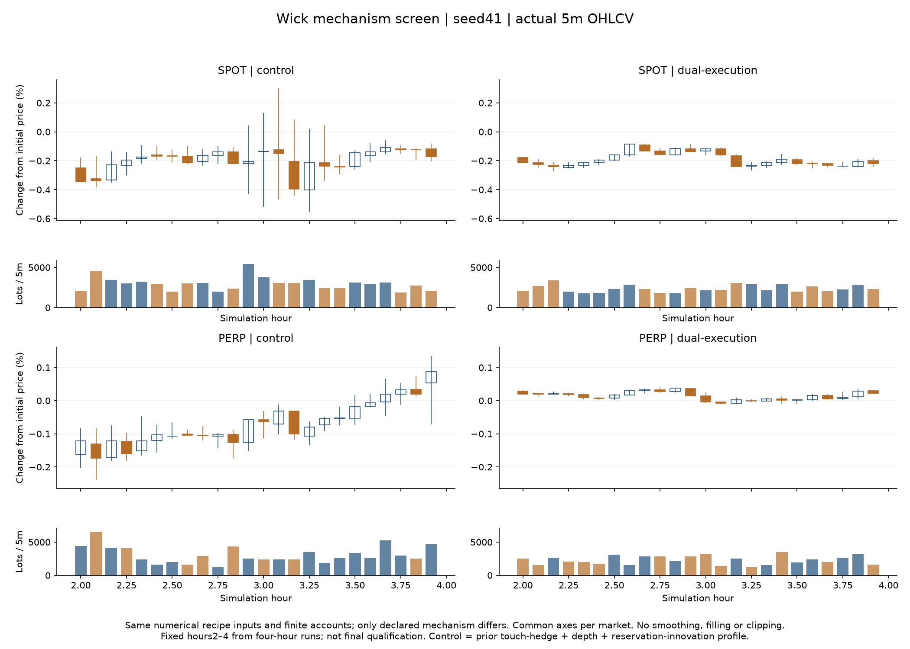

# 长上下影线：四小时初筛快照

记录时间：2026-10-25T16:21:29.236378+08:00。

反应型订单与风格交易者的触价分批执行已实现，固定种子41初筛中长影线明显减少。四种子12小时完整复验已另文完成，见[完整结果](2026-10-25-market-wicks.md)。本页仍只记录4小时初筛，不能替代完整市场资格判断。首次长运行的内存中断记录保留，后续已在新目录以相同输入完成重试。

固定条件：300个有限资金bot，每组4小时，主窗口[2h,4h)，每市场120根1m和24根5m。数值资金、库存、费用、数量分布、目标策略、滑点及止损配置相同，只改变两个插件的执行版本；实际需求到达、成交和价格会内生变化。

| 市场／配方 | 1m影线占比 | 5m影线占比 | 双长影线 | 1m收益ACF1 | 1m标准差bp | 成交量 | 双边盘口 |
|---|---:|---:|---:|---:|---:|---:|---:|
| SPOT / control | 72.6% | 81.2% | 62.5% | -0.509 | 6.854 | 71,159 | 98.50% |
| SPOT / dual-execution | 50.0% | 56.3% | 16.7% | -0.144 | 1.569 | 56,767 | 100.00% |
| PERP / control | 61.5% | 74.2% | 37.5% | -0.306 | 2.168 | 74,256 | 99.49% |
| PERP / dual-execution | 55.5% | 47.1% | 12.5% | 0.001 | 0.496 | 55,029 | 100.00% |

影线占比是(上影+下影)/振幅的非零振幅柱中位数；双长影线指上下各至少占本柱振幅25%。两市场成交量分别保留控制约80%／74%，每分钟都有实际成交。波动也明显下降，因此不能只凭振幅变小认定成功；归一化形态、相关性、活动和后半程必须一起验证。

实现：ReactiveFlowTrader1.1保存完整原主动需求、方向和初始滑点边界，按观察到的外部最优档数量发送IOC子单，真实回执才扣量，剩余意图按既有TTL有限存续。StyleSwitchingTrader1.1保持原目标仓位、信号、随机数、子单容量系数和止损规则，只进一步按最优档可成交量和价格执行，实际账户仓位决定下次残差。没有修改OHLCV、平滑、过滤极值或补造空柱。

Reactive旧主动IOC没有父单且指令有效期固定10秒；新父需求把既有order_ttl_ms作为有限执行时限。因此固定的是数值配置，主动生命周期和到达时序确实改变。Style的目标随信号重算是原有规则，不冒充固定数量父需求。退出可能分次完成，剩余风险仍在真实账户里。

两个做市观测候选及组合未获得更均衡的改善，未叠加到此方案。初代仅反应型拆单的12小时种子41／7结果也保留：种子41永续影线仍偏多，113/240个5m极值来自风格交易者且全部多价位成交，因而提出本次后续修正。初代19／73未启动，不能算通过。

验证：最新核心测试468通过、12忽略；配方11通过、分析10通过。旧二进制独立4小时控制与三个新二进制控制逐字节相同；风格新二进制只启用反应型拆单时，与此前二进制也逐字节相同。该兼容证据限于4小时，未据此声称12小时旧路径全部等价。

资源中断：失败运行最后日志为step16400，精确停止步未知，标准输出为空，退出码4294967295；不把它计入完整结果或从中提取市场统计。只终止了本轮自己的原生进程，没有关闭WSL、其他项目或更改系统设置。重试配方／二进制SHA与中断前完全相同。

完整复验使用种子41、7、19、73，每组12小时，主窗口仍为[2h,12h)。本页4小时初筛不能单独支持其他时段、种子或更大规模的结论，完整结果与剩余问题另见完整报告。

[完整初筛CSV](2026-10-25-market-wicks-screen.csv)

完整证据根目录：`E:\projects\MarketForge-tuning\.local\strategy-research-wicks-20261025`。候选启用方式：在冻结depth基础配方上加`--reactive-execution sliced --style-execution touch`。旧版本和默认配方保留。
