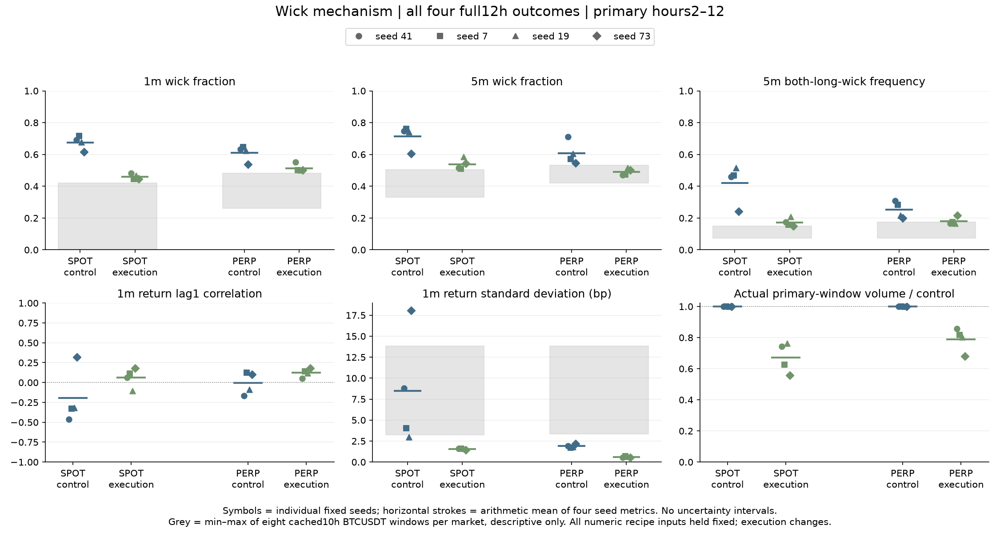
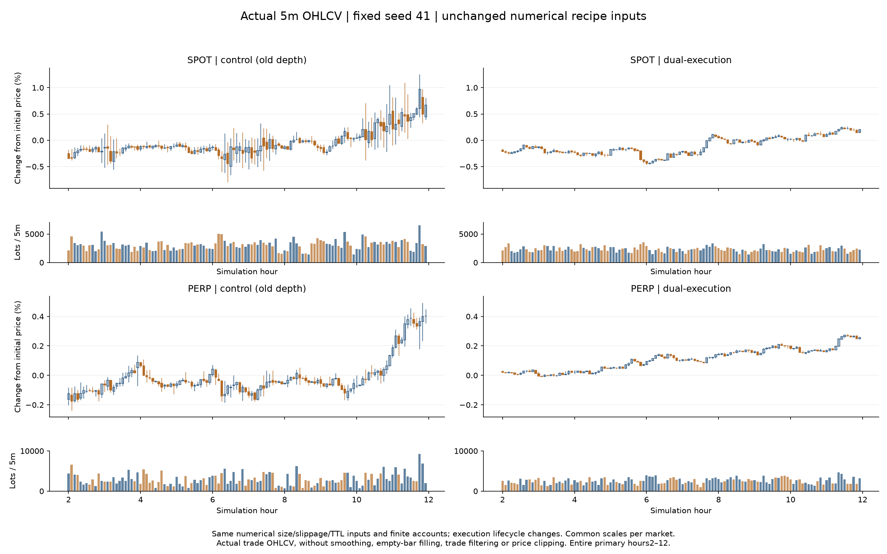
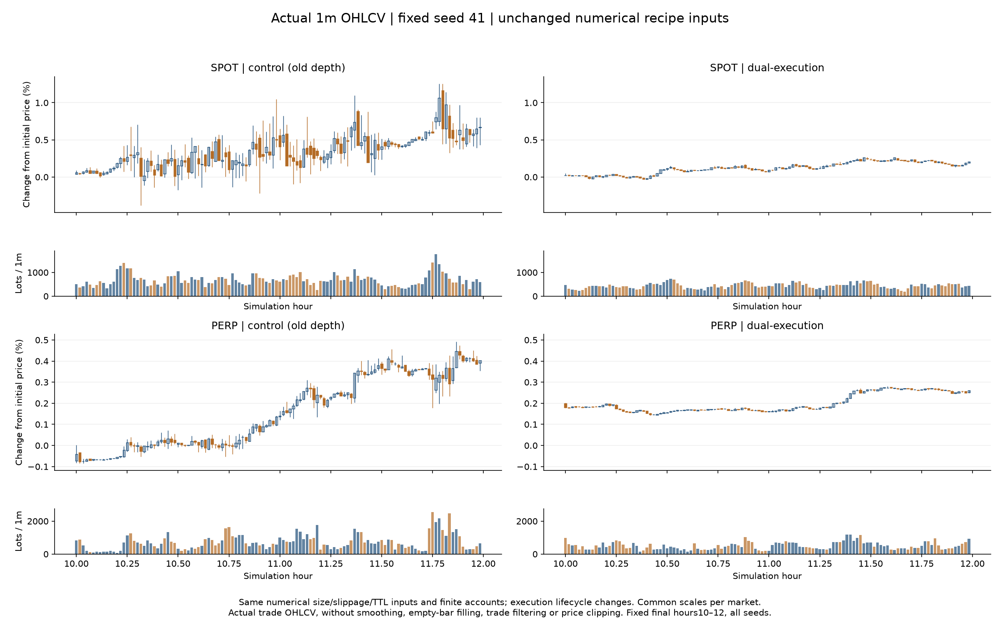
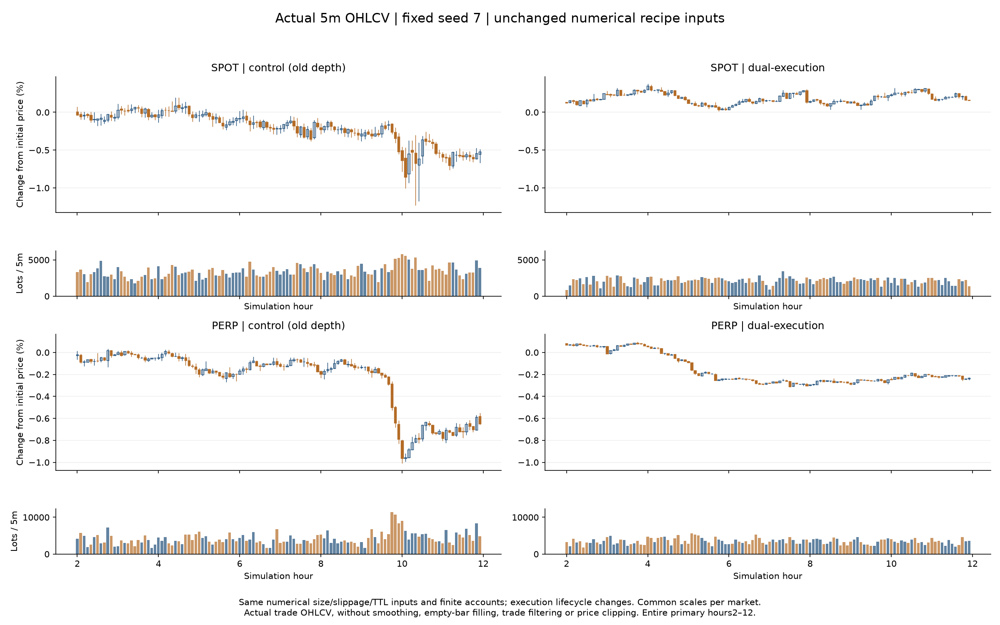
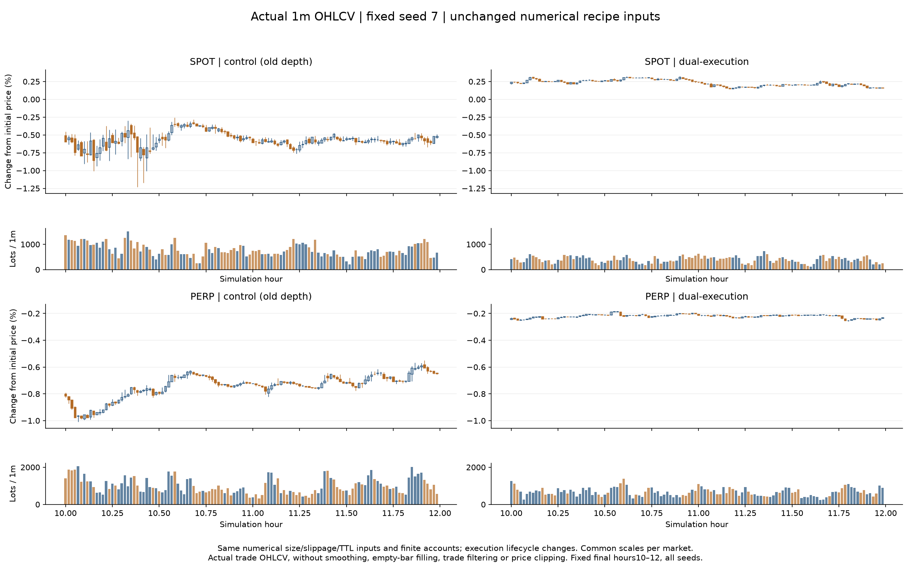
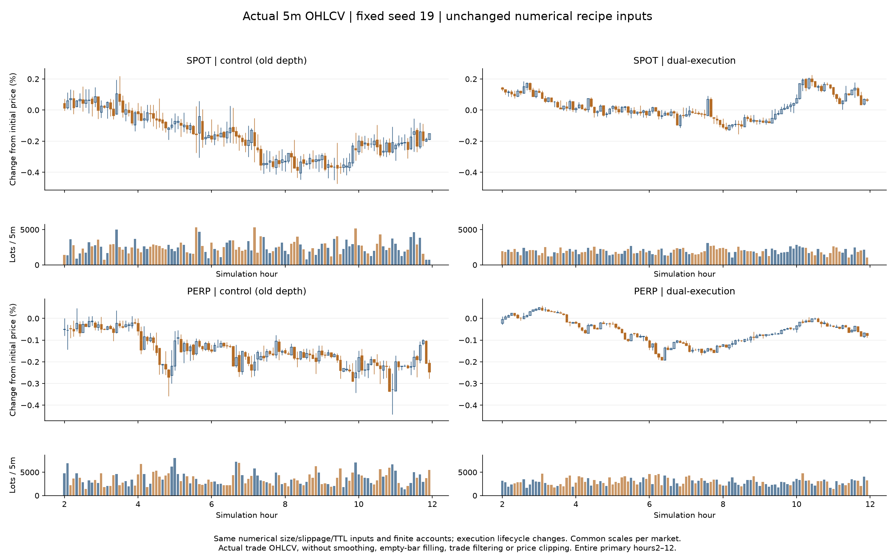
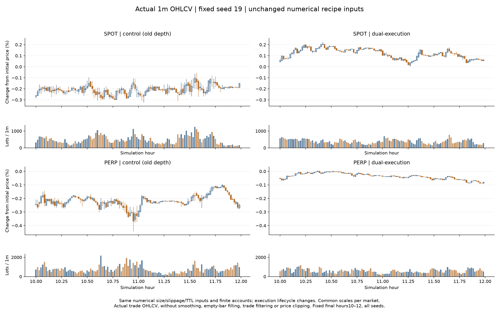
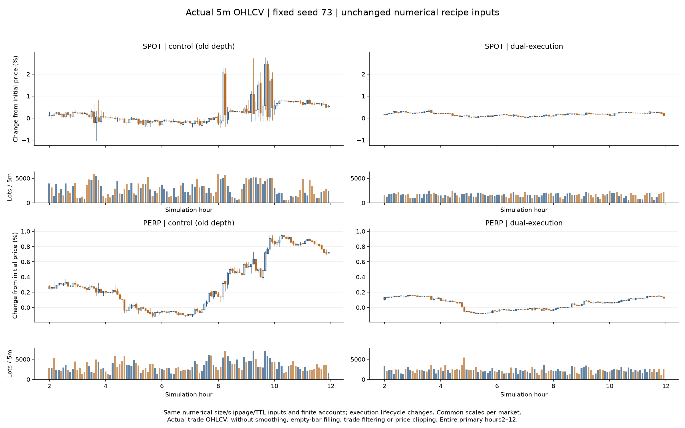
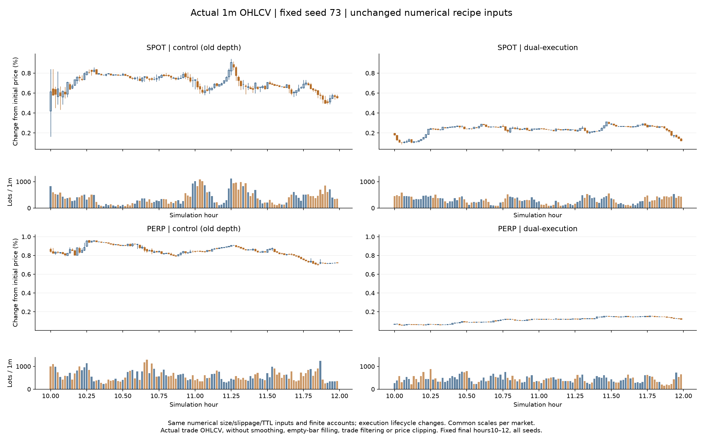

# 大量长上下影线：交易机制修复与固定种子对照

本轮将反应型交易者的一次性扫单改成有限父需求下的触价 IOC 拆单，并让风格切换交易者按最优档实际流动性执行已有目标仓位。K 线仍直接聚合原始撮合成交；未对成交OHLCV作缩放或平滑，未剔除真实极值成交或补造空柱。
本报告区分长影线问题的改善和完整市场真实性；后者尚未完成资格验证。最终数值以四个完整种子的每市场结果为准。

## 完整 12 小时复验

300 个有限资金 bot，种子 **41、7、19、73**，1 秒时钟；主统计固定为 **[2h,12h)**。每市场每种子预期 600 根 1m、120 根 5m 柱。表中影线、波动、相关性等为四个种子各自指标的算术均值，成交量为四种子的实际总量；不是把中位数误称成合并样本中位数。

| 市场／配方 | 1m影线占比 | 5m影线占比 | 5m双长影线 | 1m收益ACF1 | 1m标准差bp | 双边盘口 | 实际成交手数 |
|---|---:|---:|---:|---:|---:|---:|---:|
| SPOT / control | 67.6% | 71.4% | 42.1% | -0.196 | 8.472 | 98.23% | 1,428,905 |
| SPOT / dual-execution | 45.9% | 53.9% | 17.3% | 0.064 | 1.554 | 99.99% | 955,966 |
| PERP / control | 61.1% | 60.8% | 25.2% | -0.006 | 1.904 | 99.62% | 1,712,308 |
| PERP / dual-execution | 51.3% | 48.9% | 18.1% | 0.122 | 0.591 | 100.00% | 1,353,484 |

影线占比是 `(上影+下影)/振幅`，取非零振幅柱中位数；“双长影线”定义为上下各至少占振幅25%。这些是描述口径，不是交易信号。所有种子都保留，不能据均值隐藏失败种子。

| 市场／配方 | 账户活跃数均值 | 每种子最少非空1m柱 | 零振幅1m比例均值 | 零收益分钟比例均值 |
|---|---:|---:|---:|---:|
| SPOT / control | 132.5 | 600/600 | 0.0% | 1.3% |
| SPOT / dual-execution | 129.5 | 600/600 | 0.0% | 3.2% |
| PERP / control | 130.5 | 600/600 | 0.0% | 4.5% |
| PERP / dual-execution | 125.8 | 600/600 | 0.0% | 10.9% |

零振幅柱没有被填造成有振幅的柱；其数量单独列出，避免仅展示非零振幅影线比例掩盖市场停滞。零收益按连续分钟收盘价计算，与实体为零不是同一个口径。

| 种子 | 市场 | 5m影线：控制→执行修正 | 双长影线：控制→执行修正 | 1m ACF：控制→执行修正 | 成交量保留 |
|---:|---|---:|---:|---:|---:|
| 41 | SPOT | 74.7% → 51.6% | 45.8% → 17.5% | -0.460 → 0.064 | 74.3% |
| 41 | PERP | 71.0% → 47.1% | 30.8% → 16.7% | -0.165 → 0.050 | 85.8% |
| 7 | SPOT | 76.2% → 51.0% | 46.7% → 15.8% | -0.327 → 0.115 | 62.6% |
| 7 | PERP | 57.2% → 47.2% | 28.3% → 17.5% | 0.125 → 0.141 | 81.8% |
| 19 | SPOT | 74.2% → 58.7% | 51.7% → 20.8% | -0.315 → -0.102 | 76.2% |
| 19 | PERP | 60.5% → 51.5% | 21.7% → 16.7% | -0.088 → 0.118 | 80.3% |
| 73 | SPOT | 60.5% → 54.2% | 24.2% → 15.0% | 0.319 → 0.179 | 55.6% |
| 73 | PERP | 54.6% → 50.0% | 20.0% → 21.7% | 0.103 → 0.180 | 68.0% |

5m影线占比中位数回退分组：无。双长影线频率回退分组：['73/V-BTC-PERP: 20.0%→21.7%']。不能把总体改善表述成每一个统计量、每一分组都改善。

完整尾部、基差、活跃账户、盘口、绝对上下影线长度等在同目录 CSV 和证据 JSON 中。价格和成交量是内生结果，不宣称逐笔意图或实现成交量相同。

| 种子 | 基差绝对值中位bp：控制→执行修正 | P99bp：控制→执行修正 | 最大bp：控制→执行修正 | 收益相关：控制→执行修正 |
|---:|---:|---:|---:|---:|
| 41 | 10.32 → 20.41 | 42.49 → 53.43 | 72.33 → 55.14 | 0.189 → 0.282 |
| 7 | 9.58 → 37.95 | 33.11 → 55.96 | 37.40 → 57.64 | 0.260 → 0.213 |
| 19 | 6.31 → 7.60 | 22.69 → 20.07 | 26.00 → 21.66 | 0.083 → 0.176 |
| 73 | 14.54 → 12.47 | 134.92 → 20.36 | 174.15 → 23.01 | 0.481 → 0.275 |

基差中位数或P99回退的种子：[41, 7, 19]。这是实际回退，不因影线改善而隐藏；不能据本轮结果宣称跨市场联动或全部市场统计已经校准。各项最高点和均值要分别判断。

| 种子 | 套利账户平均处于容量上限：控制→执行修正 | 平均未对冲时间：控制→执行修正 | 事件最大残差：控制→执行修正 | 结束时最大绝对残差：控制→执行修正 |
|---:|---:|---:|---:|---:|
| 41 | 0.7% → 43.1% | 5.5% → 3.6% | 41 → 39 | 1 → 0 |
| 7 | 2.9% → 69.6% | 3.0% → 2.0% | 19 → 30 | 0 → 0 |
| 19 | 0.0% → 0.0% | 0.9% → 0.2% | 12 → 23 | 0 → 0 |
| 73 | 0.0% → 0.0% | 15.0% → 1.6% | 25 → 24 | 0 → 3 |

上述残差按原始有序成交重建两腿真实仓位，含跨主窗口边界带入的敞口；同时间戳内的腿间风险可形成事件级最大值而没有持续时长。容量占用是实际头寸约束，不能单凭它证明每个错失套利机会的原因。资金与持仓上限维持控制配方数值。

## 为什么旧版普遍有长影线

旧 depth 控制的四种子、十小时主窗口中，现货 5m 极值约91%—98%来自实际吃到多个价位的主动单；极值供给绝大多数是做市报价。按极值成交归属统计，反应型小额交易者贡献现货813/960、永续684/960个5m高低点（相同极值取首次）。这说明小额交易者的厚尾需求相对薄盘口并不总是小单。
在之前选定的150—161分钟追踪窗口，现货22/22个有正偏离的极值，在1秒后的盘口中间价上已回吐至少一半偏离；永续为19/20。它们是依赖、内生的描述样本，不是隔离事件的因果估计。原始公共中间价也有往返，因此不能把全部异常归为买卖价差。
频繁撤单与极值有时间关联，但该窗口未见单次撤单撤掉双边盘口，单次撤单中间价跳变P99很小；没有把撤单笼统定为主因。实际修复针对一次性扫深后迅速回补的执行循环，因果证据来自同配方的执行机制对照，而不是只凭这些相关性归因。

## 实现

`ReactiveFlowTrader` 1.1.0 保存抽到的方向、原始完整需求数量、初始滑点价格边界。每次只按当前外部最优档数量发送触价 IOC 子单；剩余需求在下一次权威观察继续。提交、拒单、未成交 IOC 不算成交；真实自身主动成交回执才减量，且按指令序号去重。资金、库存、手数和自成交保护继续由真实账户和撮合检查。恢复状态保留父需求和回执游标。
父需求使用既有 `order_ttl_ms` 配置作为有限执行时限，到期取消剩余意图。旧版主动 IOC 没有父单，指令有效期固定10秒；新版子单有效期止于父需求截止时间。因此固定的是原数值配方，主动生命周期、需求到达时序和指令有效期语义有意改变。父需求存续时推迟下一次新需求，后续随机数消耗及实际需求数量会内生变化。被动需求保留原行为。

`StyleSwitchingTrader` 1.1.0 保留原来的目标仓位、信号、风格抽样、子单容量系数与止损规则，只进一步把IOC子单限制到观察到的外部最优档数量和价格，且该档必须仍在原滑点边界内。后续剩余目标由实际账户仓位决定，不把提交量当作已完成仓位。目标随市场信号重算是原有规则；不声称保留一个永不撤销的固定父需求。退出可能经历多个观察，实际剩余风险仍在账户中。

| 市场 | 原主动需求 | 真实子单成交 | 到期剩余 | 运行结束仍待执行 | 实际主动成交差额 |
|---|---:|---:|---:|---:|---:|
| SPOT | 1,162,273 | 999,712 | 162,530 | 31 | 0 |
| PERP | 1,292,518 | 1,273,592 | 18,925 | 1 | 0 |

上表仅为反应型交易者的需求账本，覆盖包含预热的整个运行，与上方十小时成交统计的窗口不同。逐账户验证 `原需求 = 真实成交 + 到期剩余 + 当前待执行`，并独立按原始主动成交核对；不能把需求到期当成成交。风格交易者使用实际仓位与目标差额，不能把它冒充固定数量父需求。

## 全部初筛结果与被拒绝的组合

种子41，每组4小时，固定主窗口[2h,4h)，每市场24根5m柱，仅属探索性初筛。所有13个初筛运行（观测4组、反应型拆单5组、风格执行2×2因子4组，含各自控制）均保留。初代反应型完整复验在仅前两组拆单初筛完成时推进，当时结果单独保存；其余初筛继续完成。
初代12小时种子41虽改善现货，永续仍有较多双影线，且113/240个永续5m极值来自风格交易者，全部多价位成交。因此整组初代不再作为完整修复候选推进：在种子7结果尚未出来时记录拒绝决定，让已经启动的7跑完，未启动19／73。原四种子计划原封保留，不能把未启动两组算通过或据此声称初代四种子资格通过。旧Python启动器在原生运行之间停止，当时没有取消原生实验。最终组合重新冻结全部四种子，首次长运行在主机可用提交内存不足1GB时主动中止自己的原生进程；原始失败记录保留，四种子在新目录以完全相同输入重试并完成。没有关闭WSL、其他项目或更改系统设置。
该风格修正是根据初代完整结果提出的后续探索，不是原始预注册假设或独立留出验证。每阶段选择快照、拒绝范围、停止回执与失败组合都保留。

| 初筛 | 配方 | 市场 | 5m影线占比 | 双长影线 | 1m标准差bp | 1m ACF1 |
|---|---|---|---:|---:|---:|---:|
| 观测 | control | SPOT | 81.2% | 62.5% | 6.854 | -0.509 |
| 观测 | control | PERP | 74.2% | 37.5% | 2.168 | -0.306 |
| 观测 | penetration | SPOT | 78.8% | 54.2% | 3.682 | -0.251 |
| 观测 | penetration | PERP | 68.9% | 33.3% | 2.780 | -0.244 |
| 观测 | candleflow | SPOT | 86.9% | 91.7% | 13.987 | -0.457 |
| 观测 | candleflow | PERP | 68.2% | 33.3% | 2.098 | -0.180 |
| 观测 | both | SPOT | 89.5% | 54.2% | 4.145 | -0.377 |
| 观测 | both | PERP | 71.9% | 20.8% | 1.405 | -0.163 |
| 反应型执行 | control | SPOT | 81.2% | 62.5% | 6.854 | -0.509 |
| 反应型执行 | control | PERP | 74.2% | 37.5% | 2.168 | -0.306 |
| 反应型执行 | sliced | SPOT | 59.0% | 25.0% | 2.363 | -0.145 |
| 反应型执行 | sliced | PERP | 48.6% | 12.5% | 1.263 | -0.091 |
| 反应型执行 | sliced-penetration | SPOT | 62.4% | 25.0% | 3.439 | -0.161 |
| 反应型执行 | sliced-penetration | PERP | 64.5% | 29.2% | 2.717 | -0.307 |
| 反应型执行 | sliced-candleflow | SPOT | 68.6% | 25.0% | 1.948 | -0.068 |
| 反应型执行 | sliced-candleflow | PERP | 60.0% | 16.7% | 1.700 | -0.151 |
| 反应型执行 | sliced-both | SPOT | 59.4% | 12.5% | 3.720 | -0.055 |
| 反应型执行 | sliced-both | PERP | 60.0% | 29.2% | 1.512 | -0.040 |
| 风格执行因子 | control | SPOT | 81.2% | 62.5% | 6.854 | -0.509 |
| 风格执行因子 | control | PERP | 74.2% | 37.5% | 2.168 | -0.306 |
| 风格执行因子 | sliced | SPOT | 59.0% | 25.0% | 2.363 | -0.145 |
| 风格执行因子 | sliced | PERP | 48.6% | 12.5% | 1.263 | -0.091 |
| 风格执行因子 | styled | SPOT | 67.4% | 33.3% | 3.183 | -0.151 |
| 风格执行因子 | styled | PERP | 59.2% | 20.8% | 1.192 | 0.041 |
| 风格执行因子 | dual-execution | SPOT | 56.3% | 16.7% | 1.569 | -0.144 |
| 风格执行因子 | dual-execution | PERP | 47.1% | 12.5% | 0.496 | 0.001 |

`penetration` 是用区间起点实际买卖一以外的穿透距离校准强度，属于替代竞争到达模型，不与原GLFT校准等价。`candleflow` 从已闭合公共秒K读取完整主动买卖量，解决最多32笔成交带的信息截断，同时引入闭柱延迟。二者及组合没有整体优于单独拆单，不作为本轮推荐配置。所有数值系数、价差边界、资金和挂量配置保持不变。

## 真实数据参照与剩余边界

历史参照为已缓存的2025-01-02、04-02、07-02、10-02的BTCUSDT现货／永续，每日期取0—10时和12—22时，共每市场八段10小时。5m影线中位数现货约33%—50%、永续约42%—53%，双长影线频率约8%—18%。它们只是跨日期描述参照，不能当作置信区间，也没有控制规模、信息、费用和波动状态差异。
同口径分钟收益标准差的事后描述参照：SPOT八窗口为3.22—13.83bp，本轮候选四种子均值1.55bp；PERP八窗口为3.34—13.85bp，本轮候选四种子均值0.59bp。候选波动低于这些历史窗口，不能宣称真实波动水平已经拟合；这八个窗口也不是市场全部状态的置信边界。该事后检查没有用于重调系数或移动主窗口。影线形态改善和波动尺度标定应分开判断。
1m与5m是主指标；15m和60m在任何完整12小时候选结果出来前补充为次要描述检查，各种子的全部结果在metrics JSON中。每种子仅10根小时柱，精度有限。启动[0,30min)的1m／5m影线另行审计并保留在同一JSON，未删掉启动成交；固定主窗口不能冒充启动阶段也已全部正常。
本轮没有证明所有正常长影线都应消失，也没有完成独立种子、亚秒队列、3300／10000 bot规模、长期资金存续或全市场统计资格验证。波动下降是移除瞬时过冲的内生结果之一，不能仅凭它宣布成功；必须结合归一化形态、真实成交量、相关性和尾部评估。

## 可复核性与验证

- 本轮21次原生尝试：20次完整完成，1次资源中断。成功运行是14组4小时控制／初筛，加6组12小时候选（初代2组、最终组合4组），共128小时；不把中断片段计入成功时长。中断最后日志为step16400，精确停止步未知，标准输出为空，退出码4294967295。中断前后候选二进制及四种子配方SHA完全一致。初代剩余2份未启动配方明确不计通过。旧四种子12小时depth控制为复用证据，不重复计入。
- 旧二进制独立4小时控制，与三个新二进制使用旧配方的完整回执逐字节相同；风格修正二进制关闭风格修正的反应型拆单配方，也与前一二进制逐字节相同。旧4小时控制的全部成交／盘口前缀还与归档12小时控制一致。两代候选种子41的4小时初筛与各自12小时运行前缀逐条一致。新二进制旧配方第4—12小时尚未另跑逐字节对照。
- 当前拆单构建为无可选feature的release原生构建；配方未实例化`pine.strategy`。没有据此声称Pine进程／进程内运行时等价。构建作用域单独记录。
- 四组最终结果的原始成交计数一致、自成交数为0，端点可用余额无负数，现货基础资产总量守恒。端点检查不能代替完整费用／保险账本或逐时点保证金资格验证。
- 核心测试468通过、12忽略；配方测试11通过，分析测试10通过。新增真实撮合部分成交、恢复、重复回执、原价格边界、有限到期、风格目标／信号／随机数／止损同输入等价与实际部分退出测试。额外验证流式解析UTF8／嵌套分隔符、截断失败和跨窗口带入敞口。中途一次Windows正在运行的测试程序锁住链接目标、一次测试夹具写入不存在字段，以及早期零数量夹具失败日志均保留；修正后最终门禁通过。
- 旧三份证据ZIP的SHA保持不变。计划、配方、冻结二进制、原始回执和运行元数据未覆盖；新证据包不包含巨大的原始JSON回执或所有外部插件运行时，路径和SHA在清单中保留。它是紧凑核查包，不能称为完全独立运行环境。

## 产物

- [完整比较CSV](2026-10-25-market-wicks-comparison.csv)
- [逐种子市场联动CSV](2026-10-25-market-wicks-market-links.csv)
- [紧凑证据ZIP](2026-10-25-market-wicks-evidence.zip)
- 工作区：`E:\projects\MarketForge-tuning`；证据根目录：`.local/strategy-research-wicks-20261025`。
- 启用方式：在本轮固定depth基础配方上，把`ReactiveFlowTrader`和`StyleSwitchingTrader`切换到1.1.0；命令行等价开关为`--reactive-execution sliced --style-execution touch`。不叠加两个失败的做市观测开关。旧插件版本和默认配方保留，未部署或推送。

